---
# GENERATED by make_static_slides.py from class_3_slides.qmd -- edit the live deck, not this file.
title: Analysis of Variance (ANOVA)
author:
  - name: Sébastien Biass
    id: sb
    orcid: 0000-0002-1919-9473
    affiliation:
      - name: Earth Sciences, University of Geneva 🇨🇭
  - name: Henry Hoult
    id: hh
    affiliation:
      - name: Earth Sciences, University of Geneva 🇨🇭
  - name: Stéphane Guerrier
    id: sg
    orcid: 0000-0003-0002-8794
    affiliation:
      - name: Earth Sciences & Pharmaceutical Sciences, University of Geneva 🇨🇭
  - name: Dominique Couturier
    id: DC
    orcid: 0000-0001-5774-5036
    affiliation:
      - name: Cancer Research UK, University of Cambridge 🇬🇧
  - name: Yuming Zhang
    id: YZ
    orcid: 0000-0003-2293-9601
    affiliation:
      - name: Department of Biostatistics, Harvard University 🇺🇸
license: "CC BY"
format:
  clean-revealjs:
    embed-resources: true
    self-contained: true
    self-contained-math: true
    mathjax: "https://cdn.jsdelivr.net/npm/mathjax@3/es5/tex-mml-chtml.js"
    slide-number: true
css: [../assets/default.css, ../assets/slides-images.css, ../assets/slides-spacing.css]
jupyter: python3
execute:
  warning: false
  message: false
editor: 
  markdown: 
    wrap: 72
---

## How does it work? {.smaller}

```{=html}
<style>
@media print {
  .has-continuation {
    display: block !important;
  }
}

/* Title slide: authors as a 2x2 grid of cards */
#title-slide .subtitle { font-size:0.75em; margin-bottom:0.6em; }
#title-slide .quarto-title-authors { display:grid; grid-template-columns:1fr 1fr; gap:0.7em 2em; margin-top:0.8em; }
#title-slide .quarto-title-author { width:auto; }
#title-slide .quarto-title-author-name { font-size:0.6em; font-weight:600; white-space:nowrap; }
#title-slide .quarto-title-author-name img { width:0.7em; vertical-align:baseline; }
#title-slide .quarto-title-affiliation { font-size:0.48em; margin:0; color:#666; }
/* Title slide: acknowledgement pinned at the bottom */
/* the note lives in the slide container and is shown only while the title slide is current */
.reveal .slides > .title-thanks { display:none; position:absolute; left:0; right:0; bottom:0.6em; margin:0; font-size:0.42em; color:#999; text-align:center; }
.reveal .slides:has(> #title-slide.present) > .title-thanks { display:block; }
</style>
<script>
document.addEventListener("DOMContentLoaded", function () {
  var box = document.querySelector(".reveal .slides");
  if (box && !box.querySelector(":scope > .title-thanks")) {
    var p = document.createElement("p");
    p.className = "title-thanks";
    p.textContent = "With thanks to Luca Insolia and Federico Grazi for their help in preparing this document.";
    box.appendChild(p);
  }
});
</script>
```

- The data are the outcome of a [random process]{style="color:#eb078e;"}:
  they form a [random sample]{style="color:#6A5ACD;"} of a (possibly
  conceptual) [population]{style="color:#6A5ACD;"}.
- [Statistical inference]{style="color:#eb078e;"} uses the sample to
  learn about the population: estimating quantities and testing
  hypotheses.
- [Examples of research questions:]{style="color:#eb078e;"}
  - [pharma:]{style="color:#06bcf1;"} does a new drug lower blood pressure
    more than the standard of care?
  - [earth:]{style="color:#8bb174;"} do magmas erupting through thick crust
    have a higher SiO$_2$ content than those erupting through thin crust?

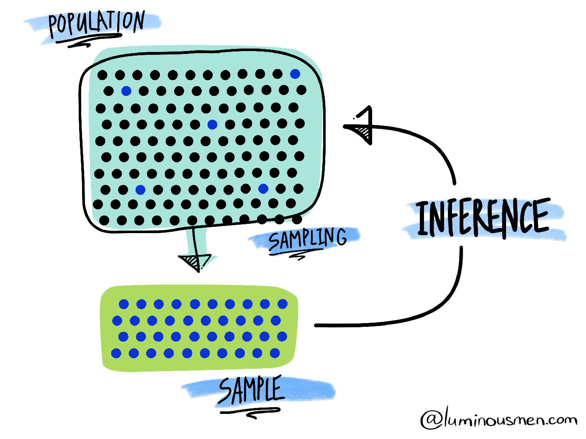{fig-align="center" width="46%"}

[Source:
[luminousmen](https://luminousmen.com)]{style="font-size:0.7em;"}

------------------------------------------------------------------------

## The big picture: p-hacking {.smaller}

[P-hacking]{style="color:#eb078e; font-weight:bold;"} is the misuse of
data analysis to find patterns that can be presented as statistically
significant: [run many tests on the data and report only those that
come back significant]{style="color:#6A5ACD;"}.
[Example:]{style="font-weight:bold;"} the number of letters in the
[Scripps National Spelling Bee](https://en.wikipedia.org/wiki/Scripps_National_Spelling_Bee)
winning word correlates with the number of people killed by venomous
spiders in the US.

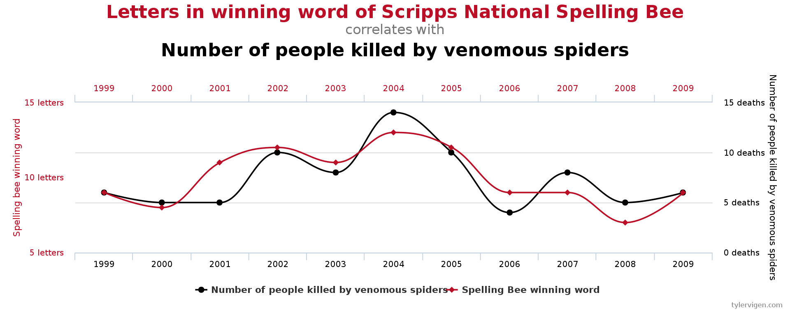{fig-align="center" width="74%" .nostretch}

[Source: [Wikipedia on data dredging](https://en.wikipedia.org/wiki/Data_dredging). 👋 If you want to know more, take a look [here](https://www.ncbi.nlm.nih.gov/pmc/articles/PMC1124898/).]{style="font-size:0.7em;"}

------------------------------------------------------------------------

## How to p-hack? 🤔 {.smaller}

Are Republicans good or bad for the US economy?
[Both!!]{style="color:#6A5ACD; font-weight:bold;"} Choose the terms,
the measure of the economy and the years, and you can "prove" either.
Try it [here](https://stats.andrewheiss.com/hack-your-way/) (a rebuild
of the original FiveThirtyEight tool, archived
[here](https://web.archive.org/web/20241222202340/https://projects.fivethirtyeight.com/p-hacking/)).

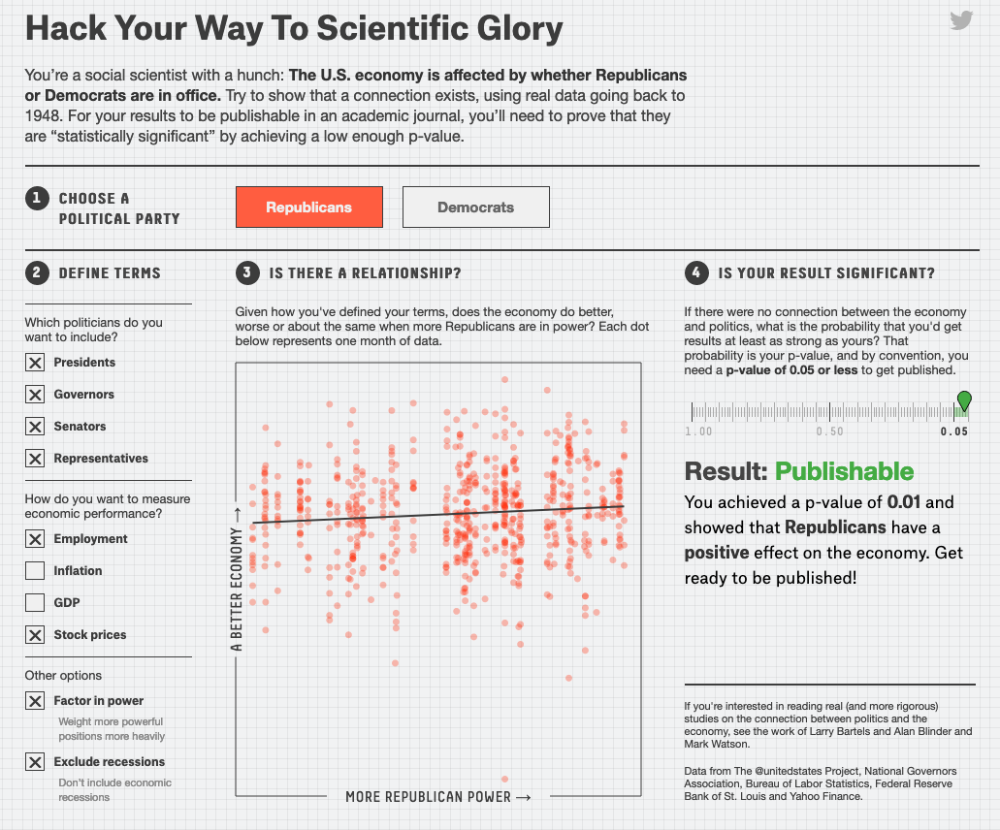{fig-align="center" width="46%" .nostretch}

## The garden of forking paths {.smaller}

::: {.columns}
::: {.column .v-center width="60%"}
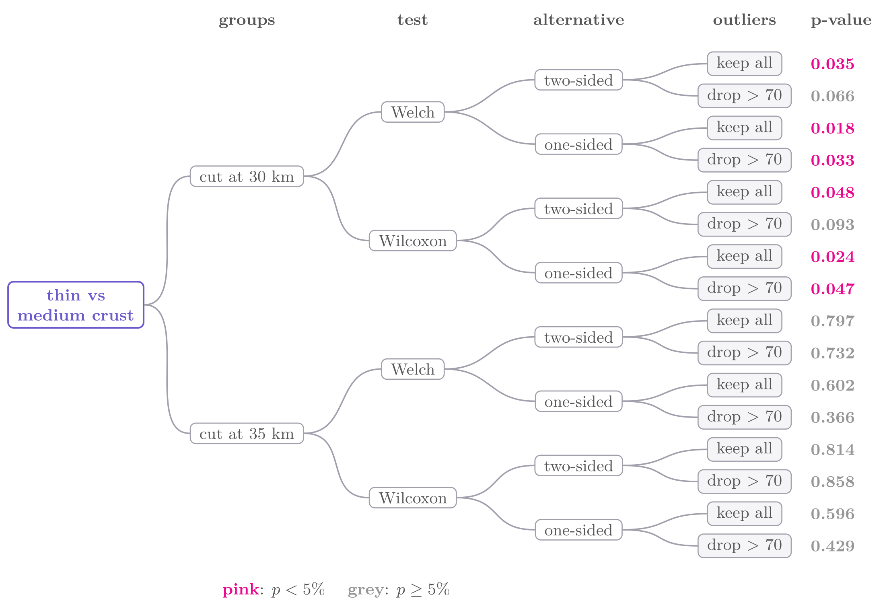{width="100%" .nostretch}
:::

::: {.column .v-center width="40%"}
::: {style="margin-left:0.6em; font-size:0.88em;"}
- No fishing needed: every analysis involves [choices made after seeing
  the data]{style="color:#eb078e;"} (which groups, which test, one- or
  two-sided, what to do with outliers, ...). Each path looks reasonable,
  and only one is reported.
- The data of this class, [16 defensible
  analyses]{style="color:#6A5ACD; font-weight:bold;"}: p-values from
  $1.8\%$ to $86\%$, six of them below $5\%$. The reported p-value
  [ignores the paths not taken]{style="color:#eb078e;"}.
- Remedies: [pre-register]{style="color:#eb078e;"} the path before
  looking at the data, or report the whole garden (multiverse analysis).
:::
:::
:::

[Gelman, A. & Loken, E. (2014), "The statistical crisis in science", *American Scientist* 102, 460. In finance: Coqueret, G. (2023), "Forking paths in financial economics", arXiv:2401.08606.]{style="font-size:0.7em;"}

------------------------------------------------------------------------

## This brings us to "HARKing" {.smaller}

::: {.columns}
::: {.column width="52%"}
[HARKing]{style="color:#eb078e; font-weight:bold;"} is an acronym
coined by Norbert Kerr for the questionable research practice of
["Hypothesizing After the Results are Known"]{style="color:#6A5ACD;"}:
presenting [a post hoc]{style="color:#06bcf1; font-weight:bold;"}
hypothesis in the introduction of a research report as if it were an
[a priori]{style="color:#06bcf1; font-weight:bold;"} hypothesis.

[How to do it?]{style="color:#eb078e; font-weight:bold;"} 🤔

- Test 20 jelly bean colours: one of them comes out linked to acne
  (more on this later).
- Pretend this was our original hypothesis.
- Et voilà!

[👋 If you want to know more, have a look [here](https://en.wikipedia.org/wiki/HARKing) and the references therein.]{style="font-size:0.85em;"}
:::

::: {.column width="48%"}
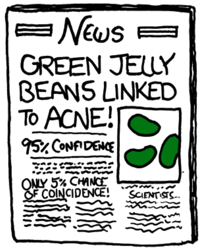{fig-align="center" width="62%" .nostretch}

[Source: [xkcd](https://xkcd.com/882/)]{style="font-size:0.7em;"}
:::
:::

------------------------------------------------------------------------

## The costs of HARKing (and p-hacking) {.smaller}

HARKing and p-hacking are (arguably) playing an important role in the
[replication crisis in science]{style="color:#6A5ACD; font-weight:bold;"}:
when 100 published psychology studies were repeated, most p-values and
effect sizes did not hold up.

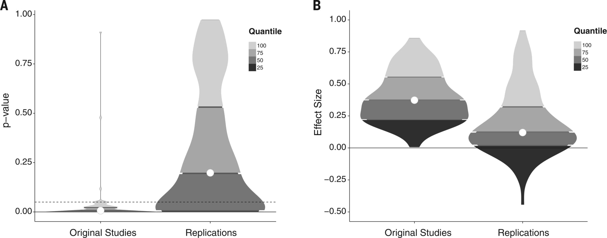{fig-align="center" width="80%" .nostretch}

[Source: [Open Science Collaboration, "Estimating the reproducibility of psychological science", *Science* 349 (2015)](https://doi.org/10.1126/science.aac4716). 👋 If you want to know more, take a look [here](https://en.wikipedia.org/wiki/Replication_crisis).]{style="font-size:0.7em;"}

------------------------------------------------------------------------

## The cost for society {.smaller}

Contradictory studies (coffee, wine, milk, ...) make the public
[cynical about science]{style="color:#eb078e; font-weight:bold;"}: "find
the study that sounds best to you and go with that". Once evidence can
be picked like that, it has [lost its power]{style="color:#6A5ACD;"}.

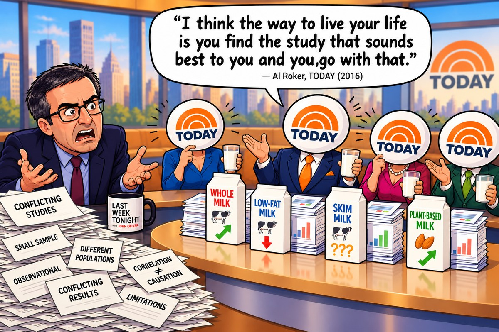{fig-align="center" width="60%" .nostretch style="border-radius:14px;"}

[👋 If you want to know more, take a look [here](https://www.youtube.com/watch?v=0Rnq1NpHdmw).]{style="font-size:0.8em;"}

------------------------------------------------------------------------

## The four horsemen of irreproducibility {.smaller}

::: {.columns}
::: {.column width="50%"}
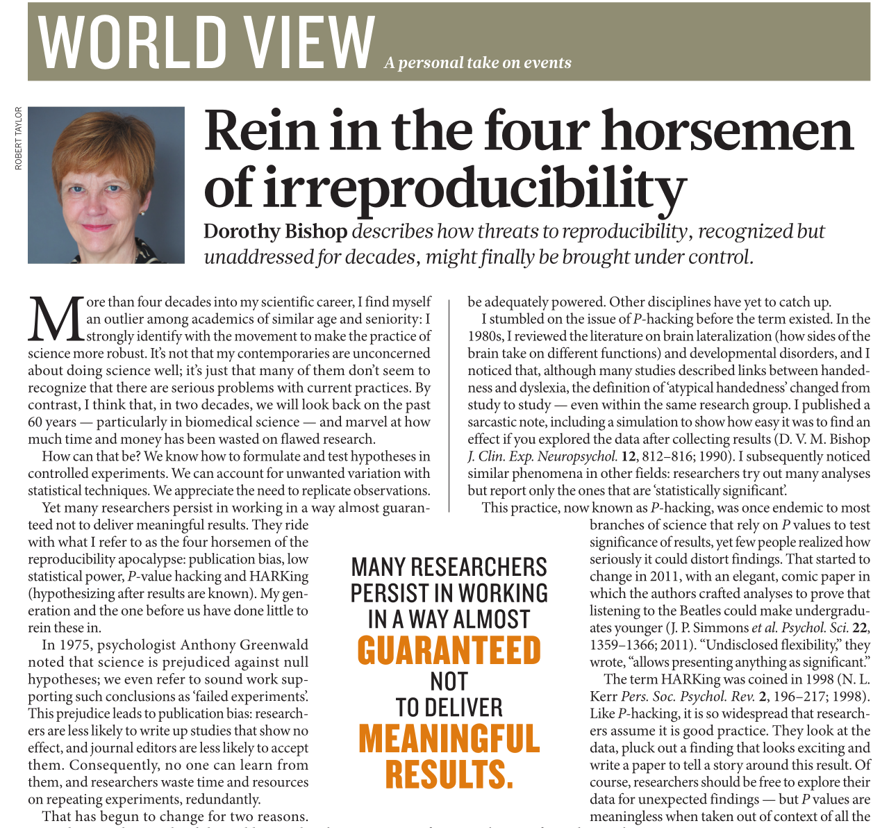{width="100%" .nostretch}
:::

::: {.column .v-center width="50%"}
::: {style="margin-left:0.8em;"}
Dorothy Bishop's four horsemen of the reproducibility apocalypse:

- [publication bias]{style="color:#6A5ACD; font-weight:bold;"}
- [low statistical power]{style="color:#06bcf1; font-weight:bold;"}
- [p-hacking]{style="color:#eb078e; font-weight:bold; white-space:nowrap;"}
- [HARKing]{style="color:#8bb174; font-weight:bold;"}

We will meet the last three today. The remedies she lists are now
standard: [pre-registration]{style="color:#eb078e;"}, registered
reports, open data and code.

[Source: [D. V. M. Bishop, *Nature* 568, 435 (2019)](https://www.nature.com/articles/d41586-019-01307-2).]{style="font-size:0.7em;"}
:::
:::
:::

------------------------------------------------------------------------

## Case study {.smaller}

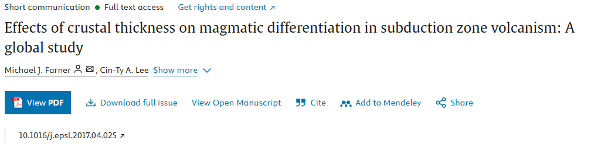{fig-align="center" width="88%"}

::: {style="font-size:1.15em;"}
[Hypothesis:]{style="color:#eb078e; font-weight:bold;"} thicker crust
above subduction zones should produce lavas with higher silica
[(SiO$_2$)]{style="white-space:nowrap;"} content.
:::

[👋 Farner, M.J. & Lee, C.-T.A. (2017). *Earth and Planetary Science
Letters*, 470, 96–107.
[doi:10.1016/j.epsl.2017.04.025](https://doi.org/10.1016/j.epsl.2017.04.025)]{style="font-size:0.6em"}

------------------------------------------------------------------------

## Case study — why would it be so? {.smaller}

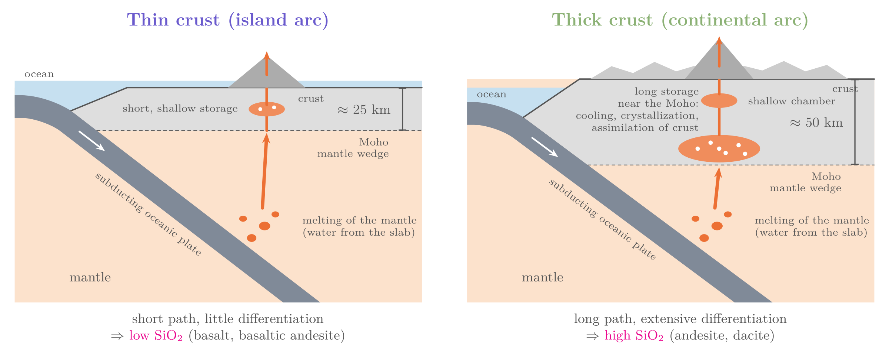{fig-align="center" width="78%"}

::: {style="font-size:0.95em;"}
- Under [thick crust]{style="color:#8bb174; font-weight:bold;"}, rising
  magmas travel further and are stored longer at depth: they cool,
  crystallize (and assimilate crust) more, so the erupted magma is more
  [differentiated]{style="color:#eb078e;"}, i.e. richer in SiO$_2$.
- [Scientific hypothesis:]{style="color:#6A5ACD; font-weight:bold;"}
  magmas erupting through thick crust have a higher SiO$_2$ content than
  those erupting through thin crust.
- [Question for this class:]{style="color:#eb078e; font-weight:bold;"}
  is this visible in the data, and how sure can we be of what we see?
:::

------------------------------------------------------------------------

## Case study — a global study {.smaller}

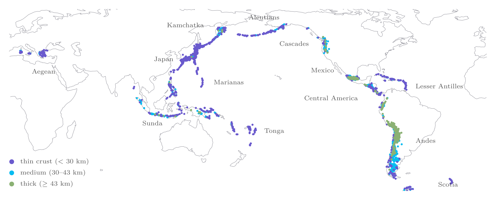{fig-align="center" width="96%"}

::: {style="font-size:0.95em;"}
- Compare magma geochemistry of samples from [multiple
  locations]{style="color:#eb078e;"}: 26 arcs, 8498 cells of
  $10 \times 10$ km (colours: crustal-thickness class, next slide).
- Data sourced from [GEOROC](https://georoc.eu/georoc/new-query2.asp),
  the public online geochemistry database.
:::

------------------------------------------------------------------------

## Case study — defining the groups {.smaller}

::: {.columns}
::: {.column width="46%"}
::: {style="font-size:0.95em; margin-top:4.2em;"}
- Sample [elevation]{style="color:#eb078e;"} used as a proxy for crustal
  thickness.
- Continuous variable (elevation, m a.s.l.) [broken into discrete
  groups]{style="color:#eb078e;"}.
- Major-element concentrations can be [compared between each
  group]{style="color:#eb078e;"} to test for statistically significant
  differences.
- E.g. SiO$_2$, MgO, FeO, CaO.
- In this class: three crustal-thickness groups,
  [thin]{style="color:#6A5ACD; font-weight:bold;"} $< 30$ km,
  [medium]{style="color:#06bcf1; font-weight:bold;"} $30$–$43$ km,
  [thick]{style="color:#8bb174; font-weight:bold;"} $\geq 43$ km, and
  SiO$_2$.
:::
:::

::: {.column width="54%"}
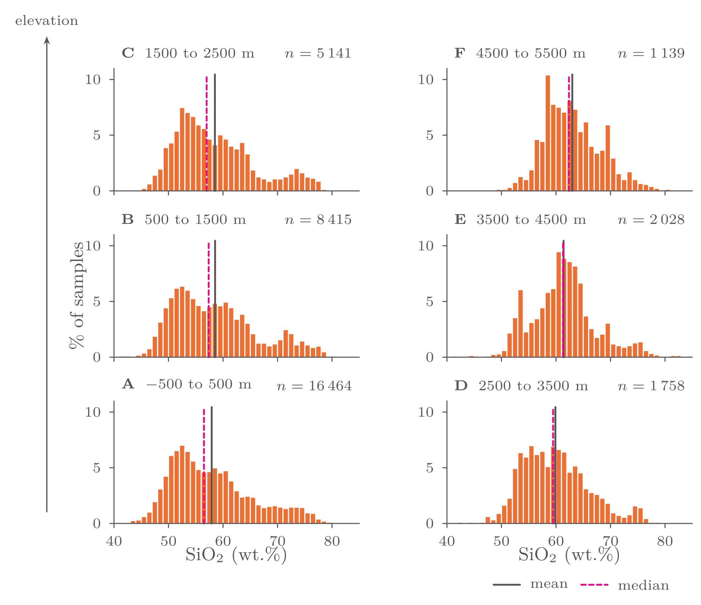{width="100%"}

[SiO$_2$ by elevation bin: Fig. 2 of Farner & Lee (2017), redrawn from their data.]{style="font-size:0.6em; color:grey;"}
:::
:::

------------------------------------------------------------------------

## Case study — the data {.smaller}

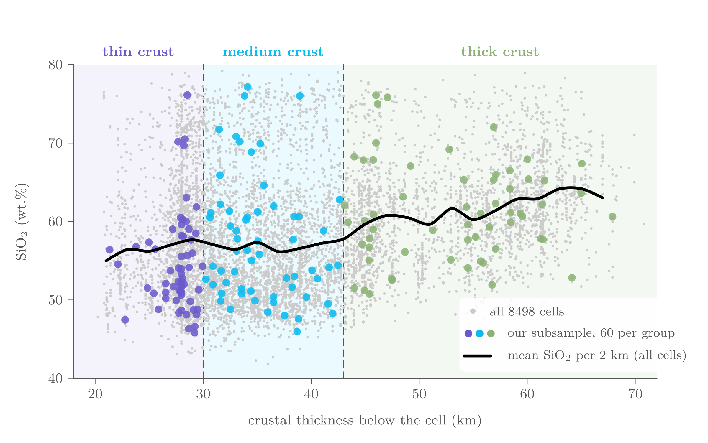{fig-align="center" width="58%"}

::: {style="font-size:0.9em;"}
- Each point is a cell. The mean SiO$_2$ per 2 km of thickness (black
  line) rises from about 56 to 63 wt.%: [the trend is
  there]{style="color:#eb078e;"}, but so is a huge scatter.
- We work with [one random subsample of 60 cells per
  group]{style="color:#eb078e;"} (coloured points; fixed seed), the size
  of a typical field study. The full dataset is on GitHub.
:::

------------------------------------------------------------------------

## Case study — a first look {.smaller}

::: {style="width:62%; margin-left:auto; margin-right:auto; font-size:1.05em;"}
| Group | $n$ | mean | sd | median |
|:------|---:|-----:|---:|-------:|
| [thin]{style="color:#6A5ACD; font-weight:bold;"} | 60 | 54.6 | 6.2 | 53.0 |
| [medium]{style="color:#06bcf1; font-weight:bold;"} | 60 | 57.3 | 7.7 | 55.4 |
| [thick]{style="color:#8bb174; font-weight:bold;"} | 60 | 61.0 | 6.4 | 60.6 |
:::

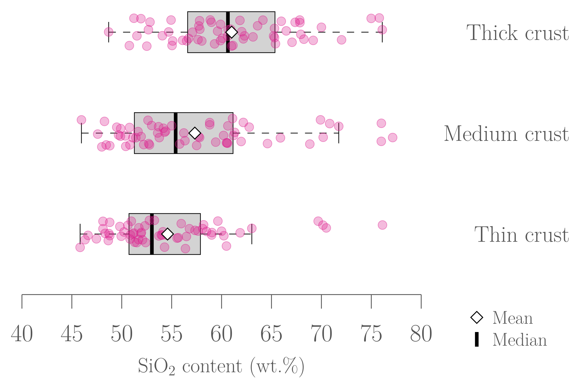{fig-align="center" width="54%" .nostretch}

------------------------------------------------------------------------

## Hypothesis testing {.smaller}

- A scientific hypothesis is translated into two [mutually
  exclusive]{style="color:#eb078e;"} statistical hypotheses:

::: {style="text-align:center;"}
$$H_0: \theta\hspace{0.1cm} {\color{#eb078e}{\in}}\hspace{0.1cm}\Theta_0 \quad \text{and} \quad H_a: \theta\hspace{0.1cm} {\color{#eb078e}{\not\in}}\hspace{0.1cm}\Theta_0$$
:::

- [Null hypothesis]{style="color:#6A5ACD;"} $\color{#373895}{H_0}$: the
  statement being tested; the test weighs the evidence
  [against]{style="color:#eb078e;"} it.
- [Alternative hypothesis]{style="color:#373895;"}
  $\color{#373895}{H_a}$: what we suspect (or hope) to be true instead.

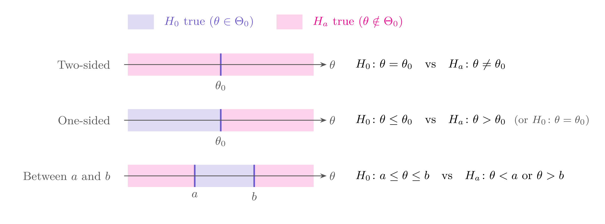{fig-align="center" width="90%"}

------------------------------------------------------------------------

## Hypothesis testing {.smaller}

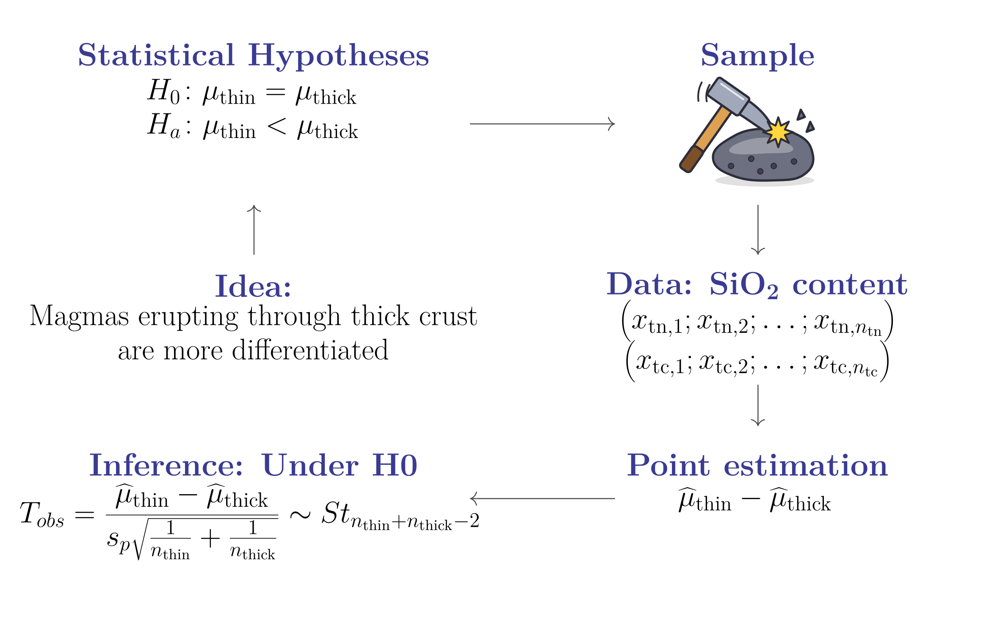{fig-align="center" width="80%"}

------------------------------------------------------------------------

## Standard procedure {.smaller}

1. [Hypotheses:]{style="color:#6A5ACD;"} state $H_0$ and $H_a$ from the
   research question.
2. [Significance level:]{style="color:#6A5ACD;"} choose $\alpha$, the
   probability of rejecting $H_0$ when it is true (typically $5\%$),
   *before* looking at the results.
3. [p-value:]{style="color:#6A5ACD;"} choose a suitable test (look at the
   data) and compute its p-value, the probability, if $H_0$ were true, of
   a result at least as extreme as the one observed (⚠️ it is **not**
   the probability that $H_0$ is true).
4. [Decision:]{style="color:#6A5ACD;"}
   - $\text{p-value} < \alpha$: [reject $H_0$ and accept
     $H_a$]{style="color:#eb078e;"}, the result is significant.
   - $\text{p-value} \geq \alpha$: [do not reject
     $H_0$]{style="color:#eb078e;"}, nothing can be concluded ("absence
     of evidence is not evidence of absence").

<br>

::: {style="font-size:1.25em;"}
| **Decision** | $H_0$ is true | $H_0$ is false |
|:-----------------|:---------------------------|:---------------------------|
| Don't reject $H_0$ | ✅ correct (prob $1-\alpha$) | ⚠️ [Type II error (prob $\beta$)]{style="color:#ff5c5c;"} |
| Reject $H_0$ | ⚠️ [Type I error (prob $\alpha$)]{style="color:#ff5c5c;"} | ✅ correct (prob $1-\beta$, the power) |
:::

------------------------------------------------------------------------

## How to understand p-values? {.smaller}

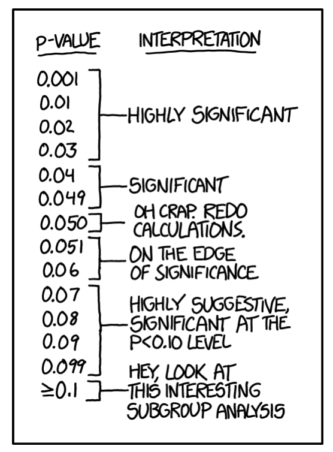{fig-align="center" width="30%"}

[👋 If you want to know more have a look
[here](https://xkcd.com/1478/).]{style="font-size:0.8em;"}

------------------------------------------------------------------------

## P-values may be controversial {.smaller}

[P-values have been misused]{style="color:#eb078e;"} many times because
understanding what they mean is not intuitive!

::: {style="text-align:center;"}
<a href="https://youtu.be/OEUJzKtCt00" target="_blank" rel="noopener"
   style="position:relative; display:inline-block; width:62%;">

<span style="position:absolute; top:50%; left:50%; transform:translate(-50%,-50%);
             width:1.6em; height:1.6em; line-height:1.6em; font-size:3.2em;
             border-radius:50%; background:rgba(235,7,142,0.85); color:white;
             text-align:center; padding-left:0.12em; box-sizing:border-box;">&#9654;</span>
</a>

[▶ Click to watch the video *p-value* on YouTube (opens in a new tab).]{style="font-size:0.7em; color:grey;"}
:::

[👋 If you want to know more have a look
[here](https://fivethirtyeight.com/features/statisticians-found-one-thing-they-can-agree-on-its-time-to-stop-misusing-p-values/).]{style="font-size:0.8em;"}

------------------------------------------------------------------------

## Student's $t$-test: a brewery story {.smaller}

::: {style="text-align:center;"}
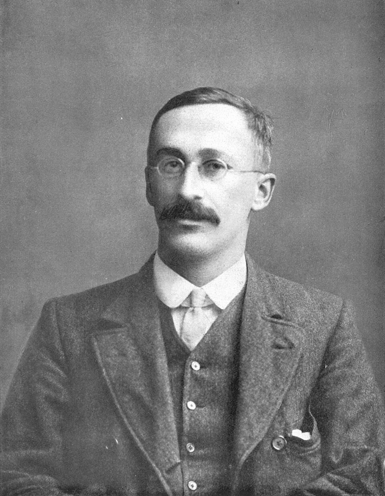{width="34%" style="border-radius:12px; vertical-align:bottom; margin-right:4%;"} 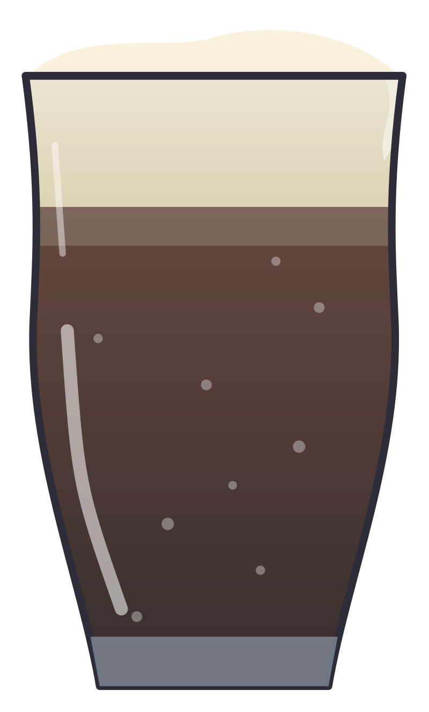{width="16%" style="vertical-align:bottom;"}
:::

::: {style="text-align:center; line-height:1.3;"}
[William Sealy Gosset, "Student" (1876–1937), Guinness brewery, Dublin, 1908.]{style="font-size:0.5em; color:#6A5ACD;"}
[Photo: public domain (Wikimedia Commons).]{style="font-size:0.4em; color:grey;"}
:::

------------------------------------------------------------------------

## Quick review: Normal distribution {.smaller}

::: {style="font-size:80%"}
$$Y\sim N(\mu,\sigma^{2}), \ \ \ \ \ f_{Y}(y) = \frac{1}{\sqrt{2\pi{\color{#6A5ACD} \sigma}^{2}}}\ e^{-\frac{(y-{\color{#6A5ACD} \mu})^{2}}{2{\color{#6A5ACD} \sigma}^{2}}}$$

$$\mathbb{E}[Y] = \mu, \ \ \ \ \ \ \ \ \ \ \ \ \text{Var}[Y] = \sigma^{2},$$

$$Z = \frac{Y-\mu}{\sigma} \sim N(0,1), \ \ \ \ \ f_{Z}(z) = \frac{1}{\sqrt{2\pi}}\ e^{-\frac{z^{2}}{2}}.$$

[Probability density function of a normal
distribution:]{style="color:#6A5ACD;"}
:::

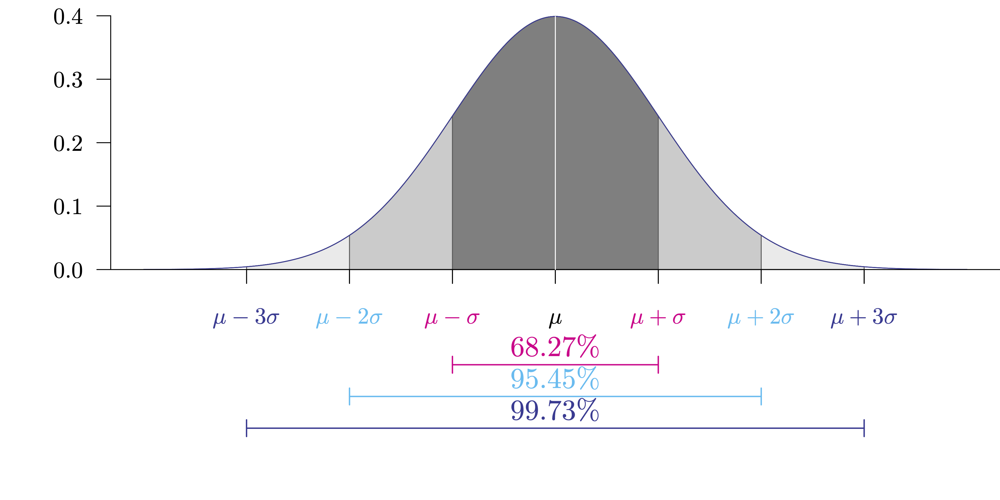{fig-align="center" width="60%"}


<!-- ------------------------------------------------------------------------ -->

<!-- ## Where are the data from? {.smaller} -->

<!-- {fig-align="center" width="95%"} -->

<!-- Each point is a $10 \times 10$ km cell containing at least one analysed -->
<!-- lava; the colour gives its crustal-thickness class. -->

<!-- ------------------------------------------------------------------------ -->

<!-- ## SiO$_2$ distributions by crustal thickness {.smaller} -->


<!-- <span style="font-size:0.9em;"> -->

<!-- - Similar to Figure 2 of Farner & Lee (2017), where the authors use -->
<!--   elevation bins instead of crustal-thickness classes. -->
<!-- - Thin and medium crust: [skewed (even bimodal)]{style="color:#eb078e;"} -->
<!--   distributions, dominated by basalts and basaltic andesites with a long -->
<!--   tail of rhyolites. -->
<!-- - Thick crust: more [symmetric]{style="color:#eb078e;"} distribution -->
<!--   centred on andesites. -->

<!-- </span> -->

------------------------------------------------------------------------

## Two-sample location tests {.smaller}

[Goal:]{style="color:#eb078e; font-weight:bold;"} compare the means (or
locations) of two independent samples. For example:

1.  A volcanologist: mean SiO$_2$ content of magmas erupting through thin
    vs medium crust.
2.  An ecologist: weight of salamanders in an old-growth forest vs a
    clear-cut area.
3.  A limnologist: duration of lake ice cover before vs after 1950.
4.  Does coffee raise blood pressure? ☕
5.  [Does the US economy grow faster under Democratic or Republican
    presidents?]{style="color:#eb078e;"} 🇺🇸 [(see the beginning of the class)]{style="color:grey;"}
6.  Is a glass of red wine as good as an hour at the gym? 🍷

We will see three tests:

1.  [Student's t-test]{style="color:#6A5ACD;"}: assumes equal variances.
2.  [Welch's t-test]{style="color:#6A5ACD;"}: no equal-variance assumption.
3.  [Mann-Whitney-Wilcoxon test]{style="color:#6A5ACD;"}: based on ranks,
    robust to outliers.

------------------------------------------------------------------------

## Student's t-test {.smaller}

Model for groups [A]{style="color:#6A5ACD; font-weight:bold;"} and
[B]{style="color:#06bcf1; font-weight:bold;"} ($g = A, B$ and
$i = 1, \ldots, n_g$), with the [same variance]{style="color:#eb078e;"}
in both groups:

$$X_{i(g)} = {\color{#eb078e}{\mu_{g}}} + \varepsilon_{i(g)}, \qquad \varepsilon_{i(g)} \overset{iid}{\sim} N(0,{\color{#eb078e}{\sigma^{2}}}).$$

Hypotheses (usually $\mu_0 = 0$) and test statistic under $H_0$ ($s_p$ =
pooled standard deviation):

$$H_0: {\color{#6A5ACD}{\mu_A}} - {\color{#06bcf1}{\mu_B}} {\color{#eb078e}{=}} \mu_0 \quad \text{vs} \quad H_a: {\color{#6A5ACD}{\mu_A}} - {\color{#06bcf1}{\mu_B}} \ \big[ {\color{#eb078e}{>}} \text{ or } {\color{#eb078e}{<}} \text{ or } {\color{#eb078e}{\neq}} \big]\ \mu_0, \qquad T = \frac{(\overline{X}_{A}-\overline{X}_{B})-\mu_0}{s_{p}\sqrt{n_{A}^{-1}+n_{B}^{-1}}} \ {\overset{H_0}{\sim}} \ \text{Student}(n_{A}+n_{B}-2).$$

::: {style="font-size:1.2em;"}
```{python}
#| eval: false
#| echo: true
from scipy import stats
stats.ttest_ind(a = ..., b = ..., alternative = ..., equal_var = True)
```
:::

- Needs approximately normal data [without
  outliers]{style="color:#eb078e;"} (for small or moderate $n$).
- The [equal-variance]{style="color:#eb078e;"} assumption is hard to
  verify: [we recommend avoiding this test in
  practice]{style="color:#eb078e; font-weight:bold;"}.

------------------------------------------------------------------------

## Welch's t-test {.smaller}

Same model and hypotheses as Student's test, but each group has
[its own variance]{style="color:#eb078e;"}:
$\varepsilon_{i(g)} \overset{iid}{\sim} N(0,{\color{#eb078e}{\sigma_g^{2}}})$.

Test statistic under $H_0$ ($df$ is computed from the data; the details
are beyond the scope of this class):

$$T = \frac{(\overline{X}_{A}-\overline{X}_{B})-\mu_0}{\sqrt{s^2_A/n_{A} + s^2_B/n_{B}}} \ {\overset{H_0}{\sim}} \ \text{Student}(df).$$

::: {style="font-size:1.2em;"}
```{python}
#| eval: false
#| echo: true
from scipy import stats
stats.ttest_ind(a = ..., b = ..., alternative = ..., equal_var = False)
```
:::

- Needs approximately normal data [without
  outliers]{style="color:#eb078e;"} (for small or moderate $n$).
- Does [not]{style="color:#eb078e;"} require equal variances. If they
  happen to be equal it loses only a little power compared to Student's
  test: [our default choice]{style="color:#eb078e; font-weight:bold;"}.

------------------------------------------------------------------------

## Thin vs medium crust — Graph {.smaller}

Do magmas erupting through
[thin]{style="color:#6A5ACD; font-weight:bold;"} and
[medium]{style="color:#06bcf1; font-weight:bold;"} crust have the same
mean SiO$_2$ content?

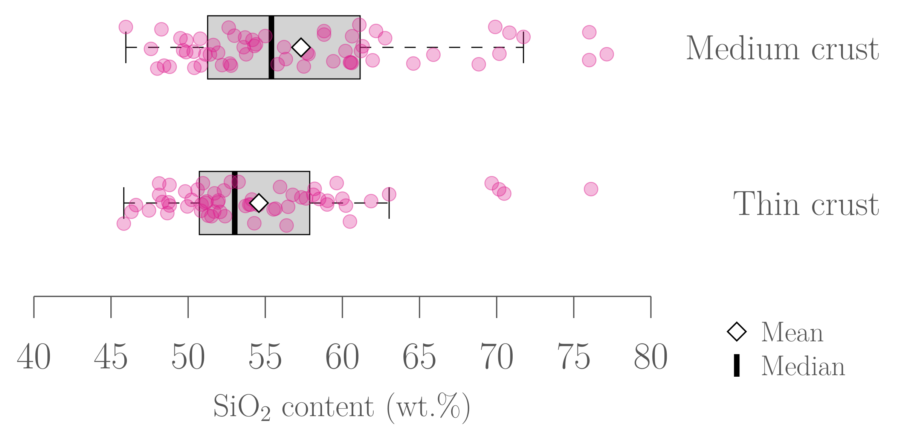{fig-align="center" width="78%" .nostretch}

[👋 Random subsample of $n = 60$ cells per group (fixed seed) from the 8498 cells of Farner & Lee (2017). The tests use the same subsample.]{style="font-size:0.6em; color:grey;"}

------------------------------------------------------------------------

## Thin vs medium crust — Import the data {.smaller}

```{python}
#| include: false
# Hidden setup: the variables used by the cells of this deck are defined once here,
# so that any cell can be run in class, even out of order.
import pandas as pd
crust = pd.read_csv("../Data/arc_magmas_crust_sample.csv")
sio2_thin   = crust["sio2"][crust["crust_class"] == "thin"]
sio2_medium = crust["sio2"][crust["crust_class"] == "medium"]
sio2_thick  = crust["sio2"][crust["crust_class"] == "thick"]
```

```{python}
#| echo: true
#| eval: false
# Import data
import pandas as pd
crust = pd.read_csv("https://raw.githubusercontent.com/ELSTE-Master/Data-Science/main/Data/arc_magmas_crust_sample.csv")

# Print the first rows of the dataset
print(crust.head(5))

# Variable of interest: SiO2 content (wt.%) for each crustal-thickness class
sio2_thin   = crust["sio2"][crust["crust_class"] == "thin"]
sio2_medium = crust["sio2"][crust["crust_class"] == "medium"]
```

```{python}
#| echo: false
# Import data
import pandas as pd
crust = pd.read_csv("../Data/arc_magmas_crust_sample.csv")

# Print the first rows of the dataset
print(crust.head(5))

# Variable of interest: SiO2 content (wt.%) for each crustal-thickness class
sio2_thin   = crust["sio2"][crust["crust_class"] == "thin"]
sio2_medium = crust["sio2"][crust["crust_class"] == "medium"]
```

------------------------------------------------------------------------

## Thin vs medium crust — Student's t-test {.smaller}

::: {style="font-size: 1.3em;"}
```{python}
#| echo: true
from scipy import stats

# Student's t-test (equal_var=True assumes equal variances)
t_stat, p_value = stats.ttest_ind(sio2_thin, sio2_medium, alternative="two-sided", equal_var=True)

print("t-statistic:", round(t_stat, 4))
print("p-value:", round(p_value, 4))
```
:::

------------------------------------------------------------------------

## Thin vs medium crust — Welch's t-test {.smaller}

::: {style="font-size: 1.3em;"}
```{python}
#| echo: true
from scipy import stats

# Welch's t-test (equal_var=False makes it Welch)
t_stat, p_value = stats.ttest_ind(sio2_thin, sio2_medium, alternative="two-sided", equal_var=False)

print("t-statistic:", round(t_stat, 4))
print("p-value:", round(p_value, 4))
```
:::

------------------------------------------------------------------------

## What if one value were wrong? {.smaller}

The smallest medium-crust value is an Andean basalt with
SiO$_2 = 46.0$ wt.%. Suppose it had been entered incorrectly: let us
give it larger and larger values and redo Welch's *t*-test.
[(Yes, a percentage cannot exceed 100: this is a thought experiment, a typing
error can produce any number.)]{style="font-size:0.8em; color:grey;"}

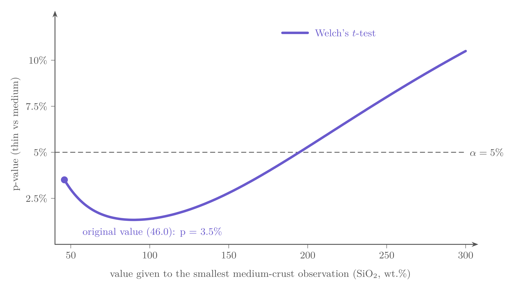{fig-align="center" width="56%"}

::: {style="font-size:0.9em;"}
- At first the p-value [decreases]{style="color:#eb078e;"}: the medium mean moves away from the thin mean.
- Then the inflated standard deviation makes the test [lose significance]{style="color:#eb078e;"}: $5.3\%$ at 200, $16\%$ at 459.6.
- [One wrong value can flip the conclusion]{style="color:#eb078e; font-weight:bold;"}: we need a test robust to such values.
:::

------------------------------------------------------------------------

## Mann-Whitney-Wilcoxon test {.smaller}

Model for groups [A]{style="color:#6A5ACD; font-weight:bold;"} and
[B]{style="color:#06bcf1; font-weight:bold;"}, [without
normality]{style="color:#eb078e;"}:
$X_{i(g)} = {\color{#eb078e}{\theta_{g}}} + \varepsilon_{i(g)}$,
$\varepsilon_{i(g)} \overset{iid}{\sim} (0,\sigma^{2})$, where
$\theta_g$ is the population [location]{style="color:#eb078e;"} of
group $g$.

$$H_0: {\color{#6A5ACD}{\theta_A}} - {\color{#06bcf1}{\theta_B}} {\color{#eb078e}{=}} \theta_0 \quad \text{vs} \quad H_a: {\color{#6A5ACD}{\theta_A}} - {\color{#06bcf1}{\theta_B}} \ \big[ {\color{#eb078e}{>}} \text{ or } {\color{#eb078e}{<}} \text{ or } {\color{#eb078e}{\neq}} \big]\ \theta_0.$$

The test statistic uses the [ranks]{style="color:#eb078e;"} of the
observations in the pooled sample, not their values ($R_{i(g)}$ = global
rank of the $i$-th observation of group $g$):

$$Z = \frac{\sum_{i=1}^{n_{B}}R_{i(B)}-n_{B}(n_{A}+n_{B}+1)/2}{\sqrt{n_{A}n_{B}(n_{A}+n_{B}+1)/12}}.$$

::: {style="font-size:1.2em;"}
```{python}
#| eval: false
#| echo: true
from scipy import stats
stats.mannwhitneyu(x = ..., y = ..., alternative = ...)
```
:::

- [Robust]{style="color:#eb078e;"}: an extreme value only changes its
  rank, however large it is.
- To compare means ($\theta_g = \mu_g$) the distributions should be
  symmetric with equal variances; otherwise it compares locations
  (medians). Slightly less powerful than the $t$-tests when their
  assumptions hold.

------------------------------------------------------------------------

## Thin vs medium crust — Wilcoxon {.smaller}

::: {style="font-size: 1.3em;"}
```{python}
#| echo: true
from scipy import stats

# Wilcoxon rank-sum test (Mann–Whitney U)
w_stat, p_value = stats.mannwhitneyu(sio2_thin, sio2_medium, alternative="two-sided")

print("Wilcoxon statistic:", round(w_stat, 4))
print("p-value:", round(p_value, 4))
```
:::

Same conclusion as Welch's *t*-test: $\text{p-value} = 4.75\% < 5\%$,
we reject $H_0$.

------------------------------------------------------------------------

## Robustness of the Wilcoxon test {.smaller}

Same experiment as before: the smallest medium-crust value is replaced
by larger and larger values.

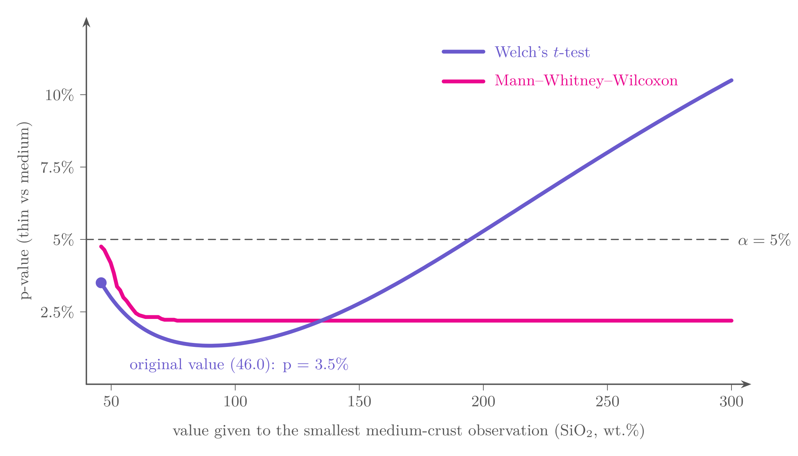{fig-align="center" width="56%"}

::: {style="font-size:0.9em;"}
- Once the value is the largest of its group its rank no longer changes:
  the Wilcoxon p-value [stays at $2.2\%$]{style="color:#eb078e;"},
  whatever the value (even 459.6).
- The $t$-test p-value crosses $5\%$ around 200 and reaches $16\%$ for
  the decimal slip.
- [Look at your data first]{style="color:#eb078e; font-weight:bold;"}:
  outliers or strong skewness are a good reason to prefer the
  Mann-Whitney-Wilcoxon test.
:::

------------------------------------------------------------------------

## Problems with multiple samples {.smaller}

::: {style="font-size:1.15em;"}
Often we need to [compare the means of more than 2 groups]{style="color:#eb078e;"}:
for example the mean SiO$_2$ content of magmas erupting through
[thin]{style="color:#6A5ACD; font-weight:bold;"},
[medium]{style="color:#06bcf1; font-weight:bold;"} and
[thick]{style="color:#8bb174; font-weight:bold;"} crust. Following
Farner & Lee (2017), our theory is that differentiation increases with
crustal thickness:

::: {style="font-size:1.5em; text-align:center; margin:0.3em 0 0.5em 0;"}
$\color{#6A5ACD}{\mu_{\text{thin}}} < \color{#06bcf1}{\mu_{\text{medium}}} < \color{#8bb174}{\mu_{\text{thick}}}$
:::

A possible approach: three one-sided tests, hoping to reject $H_0$ each time.

1.  $H_0: \color{#6A5ACD}{\mu_{\text{thin}}} = \color{#06bcf1}{\mu_{\text{medium}}}$
    vs $H_a: \color{#6A5ACD}{\mu_{\text{thin}}} < \color{#06bcf1}{\mu_{\text{medium}}}$
2.  $H_0: \color{#06bcf1}{\mu_{\text{medium}}} = \color{#8bb174}{\mu_{\text{thick}}}$
    vs $H_a: \color{#06bcf1}{\mu_{\text{medium}}} < \color{#8bb174}{\mu_{\text{thick}}}$
3.  $H_0: \color{#6A5ACD}{\mu_{\text{thin}}} = \color{#8bb174}{\mu_{\text{thick}}}$
    vs $H_a: \color{#6A5ACD}{\mu_{\text{thin}}} < \color{#8bb174}{\mu_{\text{thick}}}$

But is it OK to perform several tests on the same data? 🤔
:::

------------------------------------------------------------------------

## Is there a problem in doing many tests? {.smaller}

[Are jelly beans causing
acne?]{style="color:#6A5ACD; font-weight:bold;"} Maybe... but why only
[green]{style="color:green; font-weight:bold;"} ones? 🤨

{fig-align="center" width="32%" .nostretch}

[Source:
<a href="https://xkcd.com/882/">xkcd</a>]{style="font-size:0.7em;"}

------------------------------------------------------------------------

## Are jelly beans causing acne? {.smaller}

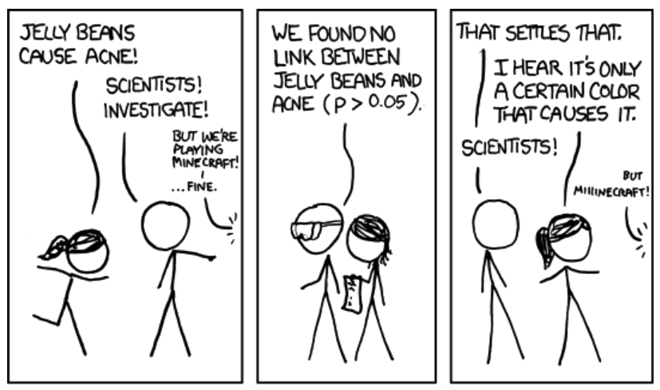{fig-align="center" width="64%" .nostretch}

[Source:
<a href="https://xkcd.com/882/">xkcd</a>]{style="font-size:0.7em;"}

------------------------------------------------------------------------

## Maybe a specific color? {.smaller}

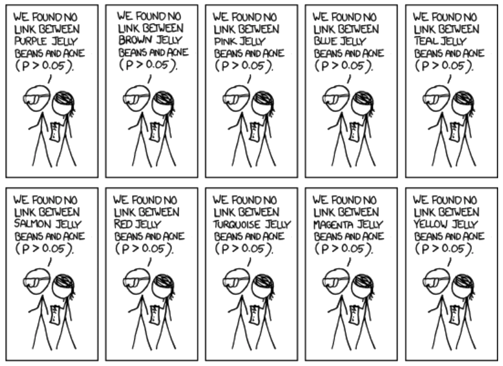{fig-align="center" width="58%" .nostretch}

[Source:
<a href="https://xkcd.com/882/">xkcd</a>]{style="font-size:0.7em;"}

------------------------------------------------------------------------

## Maybe a specific color? {.smaller}

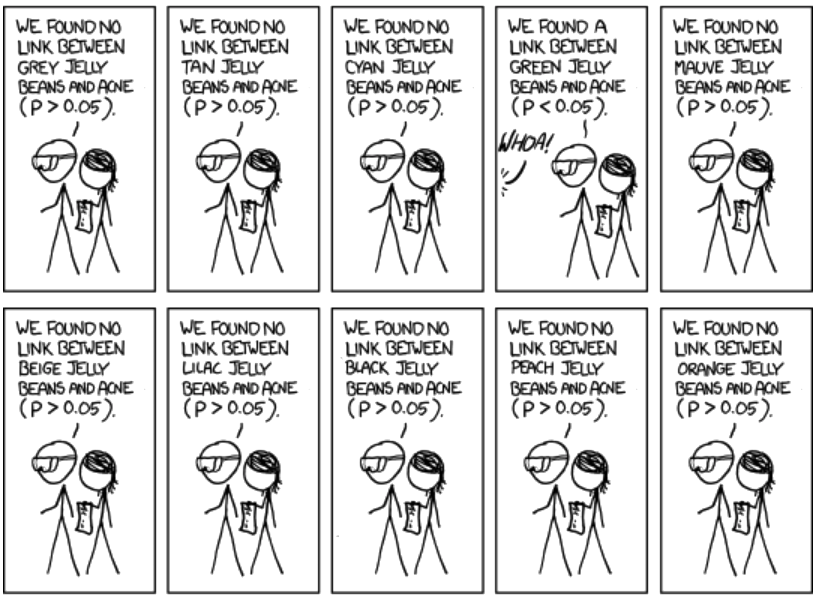{fig-align="center" width="58%" .nostretch}

[Source:
<a href="https://xkcd.com/882/">xkcd</a>]{style="font-size:0.7em;"}

------------------------------------------------------------------------

## And finally... {.smaller}

{fig-align="center" width="32%" .nostretch}

[Source:
<a href="https://xkcd.com/882/">xkcd</a>]{style="font-size:0.7em;"}

👋 [If you want to know more about this comic, have a look
<a href="https://www.explainxkcd.com/wiki/index.php/882:_Significant">here</a>.]{.smallest}

------------------------------------------------------------------------

## Multiple testing can be dangerous! {.smaller}

:::: {.columns}
::: {.column width="46%"}
- A p-value is [random]{style="color:#6A5ACD;"}: it depends on the
  data.
- One test at $\alpha = 5\%$: a $5\%$ chance of a false alarm. $k$
  tests: $k$ chances.
- For $k$ independent tests, all $H_0$ true:

$$\alpha_k = \Pr(\text{reject at least once}) = 1 - (1-\alpha)^k.$$

- [Jelly beans]{style="color:green; font-weight:bold;"}: $k = 20$
  colours, so $\alpha_{20} = 1 - 0.95^{20} \approx 64\%$. The
  "discovery" was [expected]{style="color:green;"}, not lucky.
- ⚠️ [Many tests, on the same or on different data, produce
  "significant" results even when nothing is
  there.]{style="color:#eb078e;"} Very common! 😟
:::

::: {.column width="54%"}
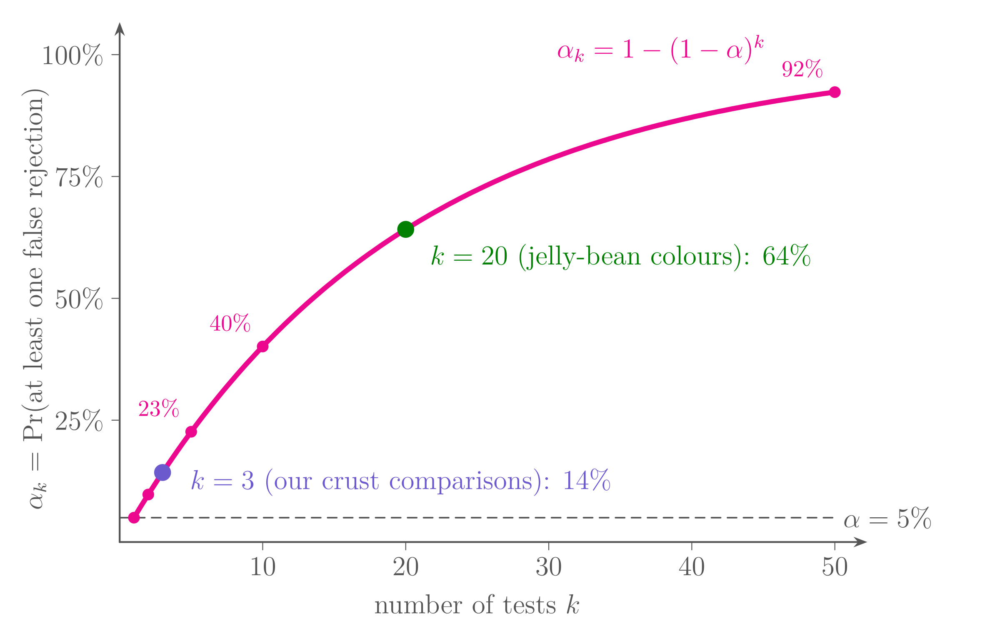{width="100%"}
:::
::::

------------------------------------------------------------------------

## Solution: a corrected level $\alpha_c$ {.smaller}

::: {style="font-size:1.12em;"}
[Idea:]{style="color:#eb078e; font-weight:bold;"} we want the chance of
at least one false rejection among the $k$ tests, $\alpha_k$, to be
$\alpha$ (say $5\%$). So we run each test at a [smaller
level]{style="color:#eb078e;"} $\alpha_c$ instead of $\alpha$.

[Boole's inequality]{style="color:#6A5ACD; font-weight:bold;"}: the
probability of a union is at most the sum of the probabilities,
whatever the dependence between the events:

$$\alpha_k = \Pr(\text{reject test 1 OR} \ \ldots \ \text{OR reject test } k) \ {\color{#eb078e}{\leq}} \ \sum_{i=1}^k \Pr(\text{reject test } i) = k \, \alpha_c.$$

Imposing $k \, \alpha_c = \alpha$ gives the [Bonferroni
correction]{style="color:#eb078e; font-weight:bold;"}:

$$\color{#6A5ACD}{\alpha_c = \frac{\alpha}{k}}.$$

- [Always valid]{style="color:#eb078e;"}: no assumption on the
  dependence between the tests, nor on how many $H_0$ are true.
- Our three crust comparisons: $\alpha_c = 5\%/3 \approx 1.67\%$. Jelly
  beans: $5\%/20 = 0.25\%$.
:::

------------------------------------------------------------------------

## Bonferroni, Dunn–Šidák and beyond {.smaller}

- Bonferroni is [conservative]{style="color:#eb078e;"}: $\alpha_k$ ends
  up below $\alpha$, so each test [loses power]{style="color:#eb078e;"},
  more and more as $k$ grows.
- For [independent]{style="color:#6A5ACD;"} tests, $\alpha_k$ is known
  exactly: $\alpha_k = 1 - (1-\alpha_c)^k$. Setting it to $\alpha$ gives
  the [Dunn–Šidák correction]{style="color:#eb078e; font-weight:bold;"}:

$$\color{#6A5ACD}{\alpha_c = 1 - (1-\alpha)^{1/k}}.$$

::: {.columns}
::: {.column width="46%"}
::: {style="font-size:1.1em; margin-top:1.2em;"}
| $k$ | 2 | 3 | 10 | 20 |
|:---|:---:|:---:|:---:|:---:|
| Bonferroni | $2.50\%$ | $1.67\%$ | $0.50\%$ | $0.25\%$ |
| Dunn–Šidák | $2.53\%$ | $1.70\%$ | $0.51\%$ | $0.26\%$ |
:::
:::

::: {.column width="54%"}
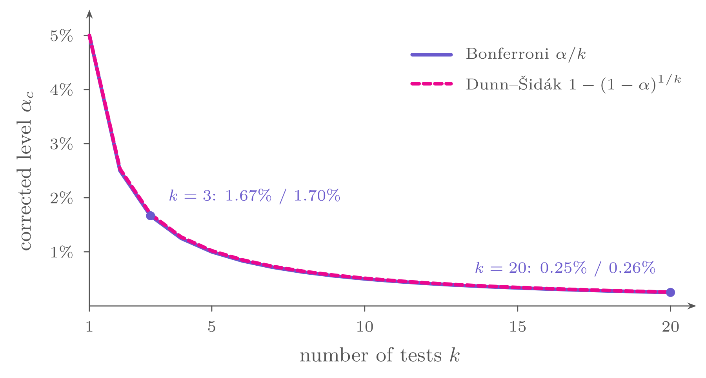{width="72%" .nostretch}
:::
:::

- Slightly less stringent, but exact [only for independent
  tests]{style="color:#eb078e;"}. Pairwise comparisons sharing a group
  are dependent: [Bonferroni is the safe
  choice]{style="color:#eb078e; font-weight:bold;"}.
- Thousands of tests (genomics): both corrections reject almost nothing.
  Methods controlling the [False Discovery
  Rate]{style="color:#eb078e;"} are used instead (beyond this class).

------------------------------------------------------------------------

## Multiple-sample location tests {.smaller}

[Goal:]{style="color:#eb078e; font-weight:bold;"} compare the means (or
locations) of $G \geq 2$ independent samples. For example, the mean
SiO$_2$ content of magmas erupting through
[thin]{style="color:#6A5ACD; font-weight:bold;"},
[medium]{style="color:#06bcf1; font-weight:bold;"} and
[thick]{style="color:#8bb174; font-weight:bold;"} crust.

Standard procedure in two steps:

- [Step 1:]{style="color:#6A5ACD;"} a [multiple-sample location
  test]{style="color:#eb078e;"} of $H_0$: "all $G$ locations are equal".
  If $H_0$ is not rejected, we stop here.
- [Step 2:]{style="color:#6A5ACD;"} otherwise, we compare the groups
  pairwise with two-sample tests at a [corrected
  level]{style="color:#eb078e;"} $\alpha_c$ (Bonferroni or Dunn–Šidák)
  to check our scientific hypothesis.

We will see three multiple-sample location tests:

1.  [Fisher's one-way ANalysis Of VAriance
    (ANOVA)]{style="color:#6A5ACD;"}: assumes equal variances.
2.  [Welch's one-way ANOVA]{style="color:#6A5ACD;"}: no equal-variance
    assumption.
3.  [Kruskal-Wallis test]{style="color:#6A5ACD;"}: based on ranks,
    robust to outliers.

👋 [Step 1 is a single test, whatever the number of groups: the
multiple-testing problem (and $\alpha_c$) only appears at Step
2.]{style="font-size:0.8em;"}

------------------------------------------------------------------------

## Fisher's one-way ANOVA {.smaller}

Model for $G$ groups ($g = 1, \ldots, G$ and $i = 1, \ldots, n_g$), with
the [same variance]{style="color:#eb078e;"} in all groups:

$$X_{i(g)} = {\color{#eb078e}{\mu_{g}}} + \varepsilon_{i(g)}, \qquad \varepsilon_{i(g)} \overset{iid}{\sim} N(0,{\color{#eb078e}{\sigma^{2}}}).$$

Hypotheses:

$$H_0: {\color{#6A5ACD}{\mu_1}} {\color{#eb078e}{=}} {\color{#06bcf1}{\mu_2}} {\color{#eb078e}{=}} \ldots {\color{#eb078e}{=}} {\color{#8bb174}{\mu_G}} \quad \text{vs} \quad H_a: \mu_i {\color{#eb078e}{\neq}} \mu_j \ \text{ for at least one pair } (i,j).$$

Test statistic under $H_0$: the variability [between]{style="color:#eb078e;"}
the group means divided by the variability [within]{style="color:#eb078e;"}
the groups, where $N = \sum_g n_g$ and $\overline{X}$ is the mean of all
$N$ observations. Means far apart compared to the noise give a large
$F$, i.e. a small p-value:

$$F = \frac{\frac{1}{G-1}\sum_{g=1}^G n_g \left(\overline{X}_g - \overline{X}\right)^2}{\frac{1}{N-G}\sum_{g=1}^G (n_g - 1)\, s_g^2} \ {\overset{H_0}{\sim}} \ \text{Fisher}(G-1,\, N-G).$$

::: {style="font-size:1.2em;"}
```{python}
#| eval: false
#| echo: true
from scipy import stats
stats.f_oneway(group_1, group_2, group_3)   # no "alternative": Ha is always "at least one pair differs"
```
:::

- Needs approximately normal data [without
  outliers]{style="color:#eb078e;"} (for small or moderate $n_g$). For
  $G = 2$ it is Student's test ($F = T^2$).
- The [equal-variance]{style="color:#eb078e;"} assumption is hard to
  verify: [we recommend avoiding this test in
  practice]{style="color:#eb078e; font-weight:bold;"}.

------------------------------------------------------------------------

## Welch's one-way ANOVA {.smaller}

Same model and hypotheses as Fisher's ANOVA, but each group has [its own
variance]{style="color:#eb078e;"}:
$\varepsilon_{i(g)} \overset{iid}{\sim} N(0,{\color{#eb078e}{\sigma_g^{2}}})$.

Test statistic under $H_0$: each group mean is weighted by its precision
$w_g = n_g / s_g^2$ (the correction in the denominator and $\Delta$ are
computed from the data; the details are beyond the scope of this
class):

$$F^* = \frac{\frac{1}{G-1}\sum_{g=1}^G w_g \left(\overline{X}_g - \overline{X}^*\right)^2}{1 + \frac{2(G-2)}{3\Delta}} \ {\overset{H_0}{\sim}} \ \text{Fisher}(G-1,\, \Delta), \qquad \overline{X}^* = \frac{\sum_{g=1}^G w_g \overline{X}_g}{\sum_{g=1}^G w_g}.$$

[For the curious:
$\Delta = \Big[\frac{3}{G^2-1} \sum_{g=1}^G \frac{1}{n_g-1} \big(1-\frac{w_g}{\sum_{h=1}^G w_h}\big)^2\Big]^{-1}$.
For $G = 2$ it is Welch's $t$-test ($F^* = T^2$ and $\Delta = df$).]{style="font-size:0.7em; color:grey;"}

::: {style="font-size:1.2em;"}
```{python}
#| eval: false
#| echo: true
from statsmodels.stats.oneway import anova_oneway
anova_oneway(data = ..., groups = ..., use_var = "unequal", welch_correction = True)
```
:::

- Needs approximately normal data [without
  outliers]{style="color:#eb078e;"} (for small or moderate $n_g$).
- Does [not]{style="color:#eb078e;"} require equal variances. If they
  happen to be equal it loses only a little power compared to Fisher's
  ANOVA: [our default choice]{style="color:#eb078e; font-weight:bold;"}.

------------------------------------------------------------------------

## Kruskal-Wallis test {.smaller}

Model for $G$ groups, [without normality]{style="color:#eb078e;"}:
$X_{i(g)} = {\color{#eb078e}{\theta_{g}}} + \varepsilon_{i(g)}$,
$\varepsilon_{i(g)} \overset{iid}{\sim} (0,\sigma^{2})$, where
$\theta_g$ is the population [location]{style="color:#eb078e;"} of
group $g$.

$$H_0: {\color{#6A5ACD}{\theta_1}} {\color{#eb078e}{=}} {\color{#06bcf1}{\theta_2}} {\color{#eb078e}{=}} \ldots {\color{#eb078e}{=}} {\color{#8bb174}{\theta_G}} \quad \text{vs} \quad H_a: \theta_i {\color{#eb078e}{\neq}} \theta_j \ \text{ for at least one pair } (i,j).$$

The test statistic applies the ANOVA idea to the
[ranks]{style="color:#eb078e;"} of the pooled sample, not to the values:
it measures how far the mean rank of each group, $\overline{R}_g$, is
from the mean of all ranks, $(N+1)/2$:

$$H = \frac{12}{N(N+1)} \sum_{g=1}^G n_g \left(\overline{R}_g - \frac{N+1}{2}\right)^2 \ {\overset{H_0}{\sim}} \ \chi^2(G-1).$$

[With ties, $H$ is divided by
$1 - \sum_{v=1}^V (t_v^3 - t_v)/(N^3 - N)$, where $t_v$ is the number of
observations sharing the $v$-th distinct value.]{style="font-size:0.7em; color:grey;"}

::: {style="font-size:1.2em;"}
```{python}
#| eval: false
#| echo: true
from scipy import stats
stats.kruskal(group_1, group_2, group_3)
```
:::

- [Robust]{style="color:#eb078e;"}: an extreme value only changes its
  rank, however large it is.
- To compare means ($\theta_g = \mu_g$) the distributions should be
  symmetric with equal variances; otherwise it compares locations
  (medians). Slightly less powerful than the ANOVAs when their
  assumptions hold.

------------------------------------------------------------------------

## Thin, medium, thick crust — Graph {.smaller}

Is the mean SiO$_2$ content of arc magmas the same for
[thin]{style="color:#6A5ACD; font-weight:bold;"},
[medium]{style="color:#06bcf1; font-weight:bold;"} and
[thick]{style="color:#8bb174; font-weight:bold;"} crust? Our theory
(Farner & Lee, 2017):
[$\mu_{\text{thin}}$]{style="color:#6A5ACD;"} $<$
[$\mu_{\text{medium}}$]{style="color:#06bcf1;"} $<$
[$\mu_{\text{thick}}$]{style="color:#8bb174;"}.

{fig-align="center" width="64%" .nostretch}

[👋 Random subsample of $n = 60$ cells per group (fixed seed) from the 8498 cells of Farner & Lee (2017). The tests use the same subsample.]{style="font-size:0.6em; color:grey;"}

------------------------------------------------------------------------

## Thin, medium, thick crust — Import {.smaller}

```{python}
#| echo: true
#| eval: false
# Import data
import pandas as pd
crust = pd.read_csv("https://raw.githubusercontent.com/ELSTE-Master/Data-Science/main/Data/arc_magmas_crust_sample.csv")

# Variables of interest: SiO2 content (wt.%) for each crustal-thickness class
sio2_thin   = crust["sio2"][crust["crust_class"] == "thin"]
sio2_medium = crust["sio2"][crust["crust_class"] == "medium"]
sio2_thick  = crust["sio2"][crust["crust_class"] == "thick"]

# Summary by class
summary = crust.groupby("crust_class")["sio2"].agg(["count", "mean", "std", "median"])
print(summary.loc[["thin", "medium", "thick"]].round(2))
```

```{python}
#| echo: false
# Import data
import pandas as pd
crust = pd.read_csv("../Data/arc_magmas_crust_sample.csv")

# Variables of interest: SiO2 content (wt.%) for each crustal-thickness class
sio2_thin   = crust["sio2"][crust["crust_class"] == "thin"]
sio2_medium = crust["sio2"][crust["crust_class"] == "medium"]
sio2_thick  = crust["sio2"][crust["crust_class"] == "thick"]

# Summary by class
summary = crust.groupby("crust_class")["sio2"].agg(["count", "mean", "std", "median"])
print(summary.loc[["thin", "medium", "thick"]].round(2))
```

------------------------------------------------------------------------

## Thin, medium, thick crust — Step 1 {.smaller}

::: {style="font-size:1.0em;"}
```{python}
#| echo: true
from scipy import stats
from statsmodels.stats.oneway import anova_oneway

# Fisher's one-way ANOVA
F_stat, p_fisher = stats.f_oneway(sio2_thin, sio2_medium, sio2_thick)
print("Fisher's ANOVA:  F =", round(F_stat, 3), " p-value =", f"{p_fisher:.1e}")

# Welch's one-way ANOVA
res = anova_oneway(crust["sio2"], groups=crust["crust_class"], use_var="unequal", welch_correction=True)
print("Welch's ANOVA:   F =", round(res.statistic, 3), " p-value =", f"{res.pvalue:.1e}")

# Kruskal-Wallis test
H_stat, p_kw = stats.kruskal(sio2_thin, sio2_medium, sio2_thick)
print("Kruskal-Wallis:  H =", round(H_stat, 3), " p-value =", f"{p_kw:.1e}")
```
:::

All three p-values are far below $5\%$: we [reject
$H_0$]{style="color:#eb078e;"}, the mean SiO$_2$ content is not the
same in the three classes. On to Step 2.

------------------------------------------------------------------------

## Thin, medium, thick crust — Step 2 {.smaller}

Three one-sided Welch $t$-tests (Tests 1 to 3), each at the Bonferroni
level $\alpha_c = 0.05/3 \approx 1.67\%$ (Dunn–Šidák would give $1.70\%$).

::: {style="font-size:0.9em;"}
```{python}
#| echo: true
from scipy import stats

alpha_c = 0.05 / 3                                      # Bonferroni correction, 3 tests

# Test 1:  H0: mu_thin = mu_medium    vs  Ha: mu_thin < mu_medium
p_1 = stats.ttest_ind(sio2_thin, sio2_medium, alternative="less", equal_var=False).pvalue
# Test 2:  H0: mu_medium = mu_thick   vs  Ha: mu_medium < mu_thick
p_2 = stats.ttest_ind(sio2_medium, sio2_thick, alternative="less", equal_var=False).pvalue
# Test 3:  H0: mu_thin = mu_thick     vs  Ha: mu_thin < mu_thick
p_3 = stats.ttest_ind(sio2_thin, sio2_thick, alternative="less", equal_var=False).pvalue

for name, p in [("Test 1 (thin < medium) ", p_1), ("Test 2 (medium < thick)", p_2), ("Test 3 (thin < thick)  ", p_3)]:
    print(name, " p-value =", f"{p:.1e}", " -> reject H0" if p < alpha_c else " -> do not reject H0")
```
:::

------------------------------------------------------------------------

## Thin, medium, thick crust — Conclusion {.smaller}

::: {style="width:76%; margin-left:auto; margin-right:auto; white-space:nowrap;"}
| Test | $H_a$ | p-value | Decision at $\alpha_c = 1.67\%$ |
|:------:|:------------------------:|:----------:|:----------------------:|
| 1 | $\color{#6A5ACD}{\mu_{\text{thin}}} < \color{#06bcf1}{\mu_{\text{medium}}}$ | $1.75\%$ | not rejected |
| 2 | $\color{#06bcf1}{\mu_{\text{medium}}} < \color{#8bb174}{\mu_{\text{thick}}}$ | $0.26\%$ | reject $H_0$ ✅ |
| 3 | $\color{#6A5ACD}{\mu_{\text{thin}}} < \color{#8bb174}{\mu_{\text{thick}}}$ | $8 \times 10^{-8}$ | reject $H_0$ ✅ |
:::

::: {style="font-size:0.9em;"}
- Magmas erupting through thick crust have a [higher mean
  SiO$_2$ content]{style="color:#eb078e;"} than those erupting through
  medium or thin crust (Tests 2 and 3).
- Thin vs medium: p-value $= 1.75\%$, just above $\alpha_c$. ⚠️ Alone at
  $\alpha = 5\%$ this test rejects $H_0$: [the correction for multiple
  testing changes the conclusion]{style="color:#eb078e;"}. And not
  rejecting does not prove that
  [$\mu_{\text{thin}}$]{style="color:#6A5ACD;"} $=$
  [$\mu_{\text{medium}}$]{style="color:#06bcf1;"}.
- The data support the thick-crust part of our theory
  [$\mu_{\text{thin}}$]{style="color:#6A5ACD;"} $<$
  [$\mu_{\text{medium}}$]{style="color:#06bcf1;"} $<$
  [$\mu_{\text{thick}}$]{style="color:#8bb174;"}, but not (yet) the
  thin-to-medium step.
- With all 8498 cells: mean SiO$_2$ of $57.1$, $56.9$ and $61.2$ wt.%,
  p-values $< 10^{-88}$ for Tests 2 and 3 but $88\%$ for Test 1: the
  thin-to-medium step is [not supported]{style="color:#eb078e;"}.
  Differentiation seems only strongly enhanced once the crust is thick.
:::
