---
# Generated by original_style/make_static.py; edit the live QMD.
title: "Linear regression"
subtitle: "Experimental clinopyroxene temperature"
author:
  - name: Sébastien Biass
    affiliation: Earth Sciences, University of Geneva
  - name: Stéphane Guerrier
    affiliation: Earth Sciences & Pharmaceutical Sciences, University of Geneva
  - name: Samuel Orso
    affiliation: Earth Sciences & Pharmaceutical Sciences, University of Geneva
format:
  revealjs:
    theme: [default, ../_extensions/grantmcdermott/clean/clean.scss]
    width: 1280
    height: 720
    margin: 0.06
    center: false
    transition: none
    view-distance: 4
    slide-number: c/t
    embed-resources: true
    self-contained-math: true
    chalkboard: false
    menu: {side: left}
    html-math-method:
      method: mathjax
      url: https://cdn.jsdelivr.net/npm/mathjax@3/es5/tex-mml-chtml.js
css: [../assets/default.css, ../assets/slides-images.css, ../assets/slides-spacing.css, class4.css, original_style/style.css]
footer: ""
toc: false
code-line-numbers: false
---

## From controlled experiments to temperature prediction {.cpx-story background-color="#ffffff"}

:::: {.story-figure}
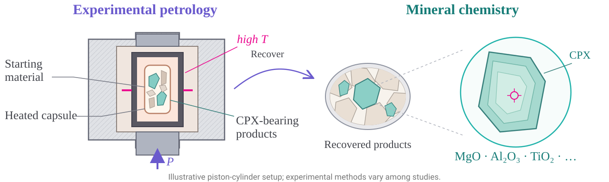{fig-alt="Illustrative piston-cylinder experiment: starting material in a heated capsule at controlled high temperature and pressure produces CPX-bearing products. Recovered products are examined; a magnified CPX grain illustrates measurement of mineral chemistry. Experimental methods vary across studies."}
::::

:::: {.story-statements}
[Physical idea:]{.purple} Clinopyroxene chemistry contains information about its formation conditions, including temperature and pressure.

[Our data:]{.turquoise} Experimental studies provide known temperatures and measured mineral compositions.

[Question for this class:]{.pink} Can we predict experimental temperature from clinopyroxene chemistry?
::::

## Motivating example: experimental clinopyroxene


:::::: {.columns}

::::: {.column width="63%"}
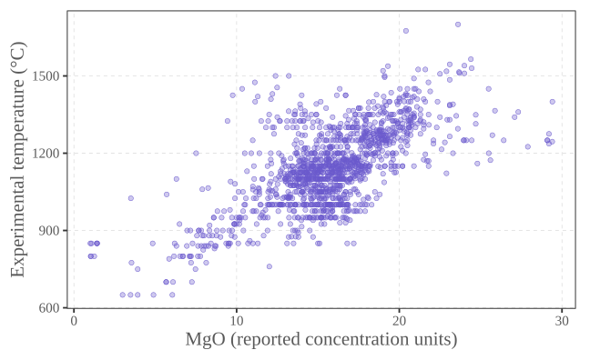{fig-alt="Training experimental temperatures plotted against MgO; an increasing relationship with substantial scatter."}

:::::

::::: {.column width="37%"}
Each point is a reported CPX analysis with a known experimental temperature.

[Can chemistry help predict temperature?]{.pink}

Regression describes the average relationship and the variation around it.


:::: {.caption}
1,402 training observations. Oxides retain their reported units; no normalization is applied.

::::

:::::

::::::

## Regression models a conditional mean


:::::: {.columns}

::::: {.column width="60%"}
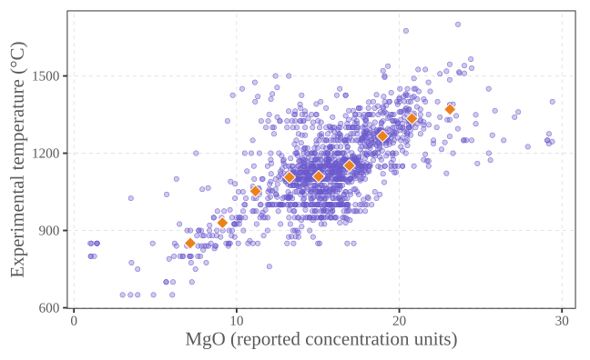{fig-alt="Purple training points and orange diamonds representing local averages in MgO bins."}

:::::

::::: {.column width="40%"}
$$T_i=\color{#6A5ACD}{m(x_i)}+\varepsilon_i$$
$$\color{#6A5ACD}{m(x)}=\mathbb E[T\mid X=x]$$

Average temperature among analyses with a given MgO value.

[Diamonds]{.orange}: averages in 2-unit MgO bins with ≥15 training records. They illustrate a mean; they are not the exact conditional expectation.


:::: {.small}
For the true conditional mean, $\mathbb E[\varepsilon\mid X]=0$.

::::

:::::

::::::

## Linear regression: a straight-line mean


:::::: {.columns}

::::: {.column width="60%"}
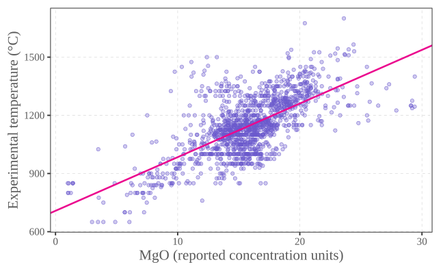{fig-alt="A pink fitted regression line through the purple training scatter."}

:::::

::::: {.column width="40%"}
$$\mathbb E[T\mid X=x]\approx\color{#6A5ACD}{\beta_0+\beta_1x}$$

$\beta_0$: intercept. $\beta_1$: slope.

The fitted line estimates the average temperature; observations still scatter around it.


:::::

::::::

## Least squares: choose the line


:::::: {.columns}

::::: {.column width="60%"}
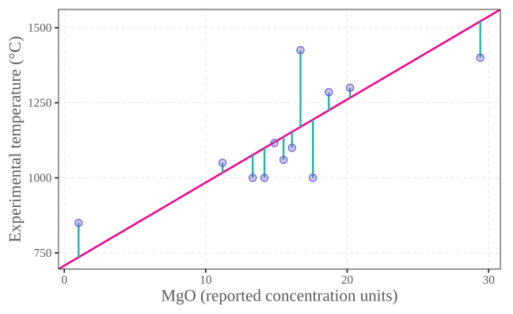{fig-alt="Twelve training records with turquoise vertical distances to the pink least-squares line."}

:::: {.caption}
12 training records shown for clarity; all 1,402 determine the line.

::::

:::::

::::: {.column width="40%"}
For any candidate line $b_0+b_1x$:

$$S(b_0,b_1)=\sum_i(T_i-b_0-b_1x_i)^2.$$

Choose $\hat\beta_0,\hat\beta_1$ to minimize $S$. These are called the **ordinary least squares (OLS) estimators**.

The [vertical distances]{.turquoise} from observations to the fitted line are residuals:

$$\color{#20B2AA}{e_i}=T_i-\hat T_i.$$


:::: {.small}
Squaring prevents cancellation and penalizes large discrepancies more strongly.

::::

:::::

::::::

## Fit a simple regression in Python {.regression-code}

:::::: {.small}
Fit the straight-line model using the supplied training observations.
::::::

```python
from cpx_lesson import load_data
import statsmodels.formula.api as smf

train, _ = load_data()
simple = smf.ols("T_C ~ MgO_Cpx", data=train).fit()
print(simple.params.round(2))
```

:::::: {.small}
`T_C ~ MgO_Cpx` specifies the response and predictor; `.fit()` estimates the OLS coefficients.
::::::

## What does a coefficient mean?


:::::: {.columns}

::::: {.column width="59%"}
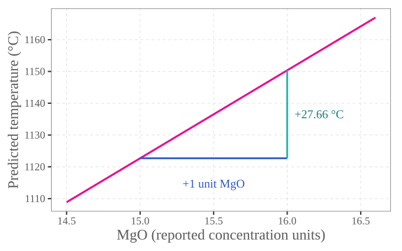{fig-alt="A step of one MgO unit along the fitted line corresponds to a predicted temperature increase of 27.66 degrees Celsius."}

:::::

::::: {.column width="41%"}
$$\hat T=707.80+\color{#eb078e}{27.66}\,\mathrm{MgO}$$

One more unit of reported MgO corresponds to **27.66 °C higher predicted mean temperature** in this simple model.

This is an association, not the effect of adding MgO to an experiment.


:::: {.small}
The intercept is the line's prediction at MgO = 0. Its algebraic role does not establish a meaningful CPX composition.

::::

:::::

::::::

## Summarize the fitted regression {.regression-code .regression-summary}

:::::: {.small}
Use `simple.summary()` to inspect the fitted model; `slim=True` gives a compact version.
::::::

::::: {.summary-panels}
:::: {.summary-code}
```python
from cpx_lesson import load_data
import statsmodels.formula.api as smf
from IPython.display import display

train, _ = load_data()
simple = smf.ols(
    "T_C ~ MgO_Cpx", data=train
).fit()
display(simple.summary(slim=True))
```
::::
:::: {.summary-output}
```{=html}
<table class="simpletable">
<caption>OLS Regression Results</caption>
<tr>
  <th>Dep. Variable:</th>       <td>T_C</td>    <th>  R-squared:         </th> <td>   0.447</td> 
</tr>
<tr>
  <th>Model:</th>               <td>OLS</td>    <th>  Adj. R-squared:    </th> <td>   0.447</td> 
</tr>
<tr>
  <th>No. Observations:</th>  <td>  1402</td>   <th>  F-statistic:       </th> <td>   1133.</td> 
</tr>
<tr>
  <th>Covariance Type:</th>  <td>nonrobust</td> <th>  Prob (F-statistic):</th> <td>1.78e-182</td>
</tr>
</table>
<table class="simpletable">
<tr>
      <td></td>         <th>coef</th>     <th>std err</th>      <th>t</th>      <th>P>|t|</th>  <th>[0.025</th>    <th>0.975]</th>  
</tr>
<tr>
  <th>Intercept</th> <td>  707.8019</td> <td>   13.286</td> <td>   53.274</td> <td> 0.000</td> <td>  681.739</td> <td>  733.865</td>
</tr>
<tr>
  <th>MgO_Cpx</th>   <td>   27.6596</td> <td>    0.822</td> <td>   33.660</td> <td> 0.000</td> <td>   26.048</td> <td>   29.272</td>
</tr>
</table><br/><br/>Notes:<br/>[1] The coefficient standard errors assume constant error variance and uncorrelated errors across observations.
```
::::
:::::

## Is the MgO slope different from zero? {.pvalue-lesson}

:::::: {.columns}
::::: {.column width="43%"}
**Two-sided hypotheses**

$$\color{#6A5ACD}{H_0:\ \beta_1=0}$$

No linear change in mean temperature with MgO in this simple model.

$$\color{#eb078e}{H_1:\ \beta_1\ne0}$$

The MgO slope is non-zero: positive or negative.
:::::
::::: {.column width="57%"}
**MgO in our fitted regression**

| $\hat\beta_1$ | Standard error | $t$ | $p$ |
|:---:|:---:|:---:|:---:|
| 27.66 | 0.82 | 33.66 | $<0.001$ |

:::: {.small}
If $H_0$ and the model assumptions hold, the **p-value** is the probability of a $t$ statistic at least as far from zero as the one observed.

`0.000` in the summary is rounded; the p-value is not zero.
::::
:::::
::::::

:::::: {.takeaway .small}
At the 5% level, under the OLS assumptions, reject $H_0$: the data support a **positive linear association** between MgO and experimental temperature.
::::::

:::::: {.caption}
A p-value is not the probability that $H_0$ is true. A small p-value does not measure effect size, prove causation, or establish prediction accuracy.
::::::

## R-squared: definition and interpretation {.r2-lesson}

$$R^2=1-\frac{\color{#6A5ACD}{\sum_{i\in\mathrm{train}}(T_i-\hat T_i)^2}}{\color{#777777}{\sum_{i\in\mathrm{train}}(T_i-\bar T_{\mathrm{train}})^2}}.$$

:::::: {.caption}
$T_i$: measured temperature; $\hat T_i$: fitted temperature; $\bar T_{\mathrm{train}}$: mean training temperature.
::::::

:::::: {.columns}
::::: {.column width="58%"}
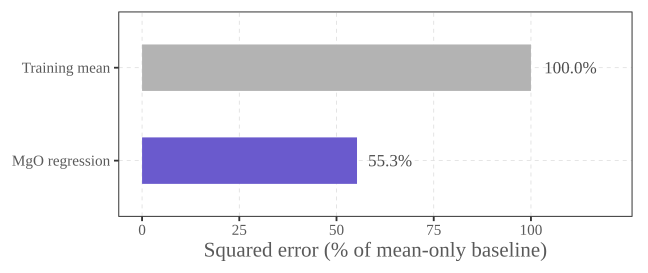{fig-alt="On the same CPX training observations, the mean-only baseline has 100 percent of the baseline squared error, and the MgO regression has 55.3 percent. R-squared is therefore 0.447, a 44.7 percent reduction."}

:::::
::::: {.column width="42%"}
[**Here, $R^2=0.447$.**]{.purple}

The fitted MgO relationship captures **44.7% of the variation in experimental training temperatures**.

:::: {.small}
This is a 44.7% reduction in squared error relative to predicting the training mean.

$R^2$ describes training fit. Check prediction accuracy on test observations.
::::
:::::
::::::

## Fit a multiple regression in Python {.regression-code}

:::::: {.small}
Fit temperature using MgO, Al₂O₃, and TiO₂ from the training observations.
::::::

```python
from cpx_lesson import load_data
import statsmodels.formula.api as smf

train, _ = load_data()
multiple = smf.ols(
    "T_C ~ MgO_Cpx + Al2O3_Cpx + TiO2_Cpx",
    data=train
).fit()
print(multiple.params.round(2))
```

:::::: {.small}
The `+` signs include all three predictors; `.fit()` estimates the OLS coefficients.
::::::

## Multiple regression: more chemical information

$$\hat T=576.32+\color{#6A5ACD}{28.37\,\mathrm{MgO}}+\color{#20B2AA}{25.10\,\mathrm{Al_2O_3}}-\color{#2b59c3}{18.62\,\mathrm{TiO_2}}$$


:::::: {.columns}

::::: {.column width="65%"}
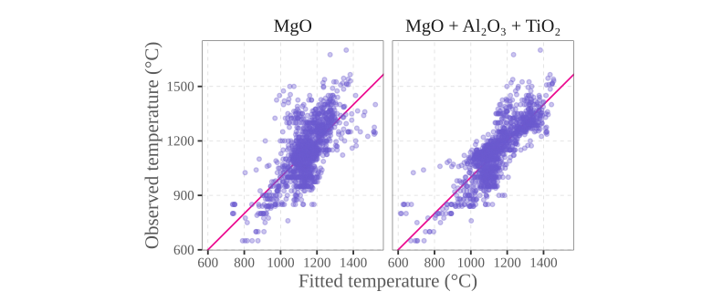{fig-alt="Observed versus fitted training temperatures for simple and multiple regression, with pink identity lines."}

:::: {.caption}
Training $R^2$: 0.447 → 0.672. Pink line: observed = fitted.

::::

:::::

::::: {.column width="35%"}
Each slope holds the other included predictors fixed.

Chemical predictors are correlated; coefficients are not independent chemical interventions.


:::: {.small}
$R^2$ summarizes training fit. Adding predictors cannot lower it on the same rows, but need not improve future predictions.

::::

:::::

::::::

## Summarize the multiple regression {.regression-code .regression-summary}

:::::: {.small}
Use `multiple.summary(slim=True)` to inspect the three-oxide model.
::::::

::::: {.summary-panels}
:::: {.summary-code}
```python
from cpx_lesson import load_data
import statsmodels.formula.api as smf
from IPython.display import display

train, _ = load_data()
multiple = smf.ols(
    "T_C ~ MgO_Cpx + Al2O3_Cpx"
    " + TiO2_Cpx", data=train
).fit()
display(multiple.summary(slim=True))
```
::::
:::: {.summary-output}
```{=html}
<table class="simpletable">
<caption>OLS Regression Results</caption>
<tr>
  <th>Dep. Variable:</th>       <td>T_C</td>    <th>  R-squared:         </th> <td>   0.672</td>
</tr>
<tr>
  <th>Model:</th>               <td>OLS</td>    <th>  Adj. R-squared:    </th> <td>   0.671</td>
</tr>
<tr>
  <th>No. Observations:</th>  <td>  1402</td>   <th>  F-statistic:       </th> <td>   954.5</td>
</tr>
<tr>
  <th>Covariance Type:</th>  <td>nonrobust</td> <th>  Prob (F-statistic):</th>  <td>  0.00</td> 
</tr>
</table>
<table class="simpletable">
<tr>
      <td></td>         <th>coef</th>     <th>std err</th>      <th>t</th>      <th>P>|t|</th>  <th>[0.025</th>    <th>0.975]</th>  
</tr>
<tr>
  <th>Intercept</th> <td>  576.3177</td> <td>   15.454</td> <td>   37.292</td> <td> 0.000</td> <td>  546.002</td> <td>  606.633</td>
</tr>
<tr>
  <th>MgO_Cpx</th>   <td>   28.3747</td> <td>    0.768</td> <td>   36.954</td> <td> 0.000</td> <td>   26.868</td> <td>   29.881</td>
</tr>
<tr>
  <th>Al2O3_Cpx</th> <td>   25.1036</td> <td>    0.821</td> <td>   30.583</td> <td> 0.000</td> <td>   23.493</td> <td>   26.714</td>
</tr>
<tr>
  <th>TiO2_Cpx</th>  <td>  -18.6177</td> <td>    4.032</td> <td>   -4.618</td> <td> 0.000</td> <td>  -26.527</td> <td>  -10.709</td>
</tr>
</table><br/><br/>Notes:<br/>[1] The coefficient standard errors assume constant error variance and uncorrelated errors across observations.
```
::::
:::::

## Interpreting multiple-regression coefficients

:::::: {.columns}
::::: {.column width="59%"}
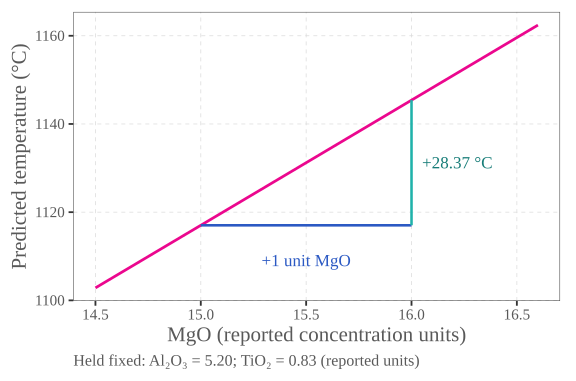{fig-alt="A pink fitted MgO relationship with Al2O3 and TiO2 held fixed. A blue horizontal step of one reported MgO unit corresponds to a turquoise vertical increase of 28.37 degrees Celsius in predicted temperature."}
:::::
::::: {.column width="41%"}
$$\Delta\hat T=\color{#eb078e}{28.37}\,\Delta\mathrm{MgO}$$

**Holding Al₂O₃ and TiO₂ fixed**, one more unit of reported MgO corresponds to **28.37 °C higher predicted mean temperature**.

:::: {.small}
The other slopes follow the same rule:

- Al₂O₃: **+25.10 °C** per reported unit.
- TiO₂: **−18.62 °C** per reported unit.

Each comparison holds the other two oxides fixed.
::::
:::::
::::::

## Model diagnostics: what remains unexplained?

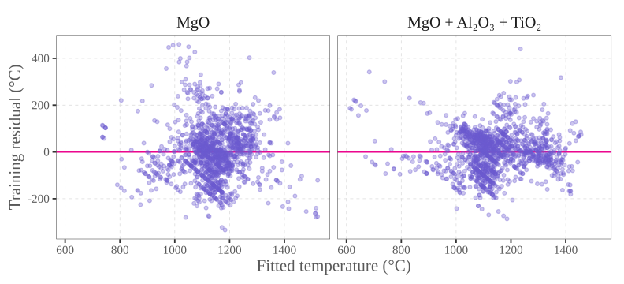{width="87%" fig-alt="Side-by-side training residuals against fitted temperature for the simple and multiple models, with pink zero lines."}


:::::: {.small}
Look for **curvature, changing spread, clusters, and unusual observations**. Zero average residual is automatic for OLS with an intercept; it does not establish model adequacy.

::::::

## From straight lines to curves

:::::: {.columns}
::::: {.column width="60%"}
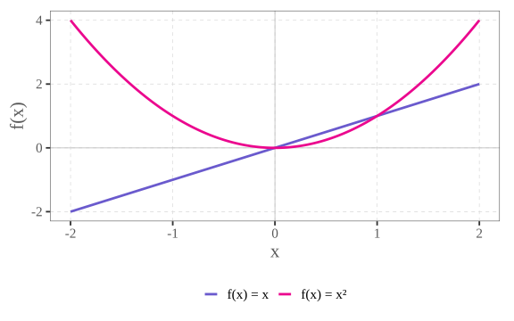{fig-alt="Mathematical illustration: f(x)=x is a straight purple line, whereas f(x)=x squared is a pink curve. This is not CPX data."}
:::::
::::: {.column width="40%"}
A straight line changes at a constant rate.

$$\color{#eb078e}{f(x)=x^2}$$

Squaring $x$ gives us another predictor. Combining $x$ and $x^2$ lets a fitted mean bend.

:::: {.caption}
Mathematical illustration, not CPX observations.
::::
:::::
::::::

## Polynomial regression {.polynomial-lesson}

$$T=\beta_0+\beta_1x+\color{#20B2AA}{\beta_2x^2}+\varepsilon,\qquad x=\mathrm{MgO}.$$

:::::: {.columns}
::::: {.column width="65%"}
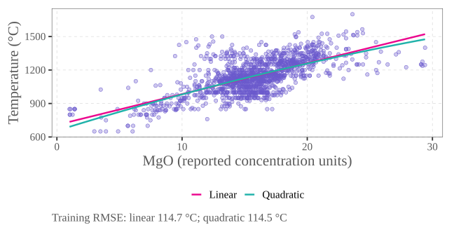{fig-alt="CPX training observations with linear and quadratic MgO regression fits. Training RMSE changes only slightly, from 114.7 to 114.5 degrees Celsius."}
:::::
::::: {.column width="35%"}
Curved in $x$, but [linear in the coefficients]{.purple}: each $\beta_j$ multiplies a known predictor.

:::: {.small}
Here, adding curvature barely changes training error. This does not establish better predictions.

The curve is an empirical approximation, not a physical law. The test set is not used to choose the polynomial degree.
::::
:::::
::::::

## A more flexible model for three oxides {.three-oxide-lesson}

$$\begin{aligned}
T={}&\beta_0+\color{#6A5ACD}{\beta_1x_1+\beta_2x_2+\beta_3x_3}\\
 &+\color{#20B2AA}{\beta_4x_1^2+\beta_5x_2^2+\beta_6x_3^2}\\
 &+\color{#2b59c3}{\beta_7x_1x_2+\beta_8x_1x_3+\beta_9x_2x_3}+\varepsilon .
\end{aligned}$$

:::::: {.caption}
$x_1=\mathrm{MgO}$, $x_2=\mathrm{Al_2O_3}$, $x_3=\mathrm{TiO_2}$, in their reported concentration units.
::::::

:::::: {.columns}
::::: {.column width="65%"}
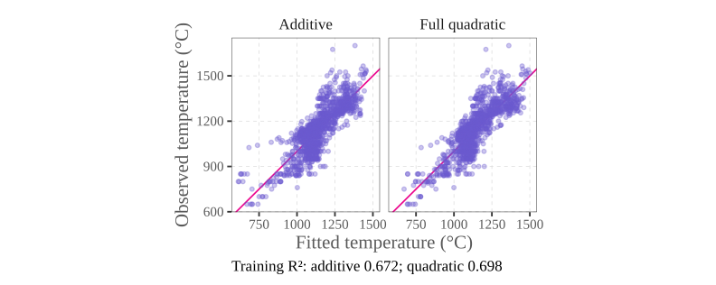{fig-alt="Observed versus fitted CPX training temperatures: the additive three-oxide model uses four coefficients and has R-squared 0.672; the full quadratic uses ten coefficients and has training R-squared 0.698. Pink lines mark observed equals fitted."}

:::::
::::: {.column width="35%"}
**10 coefficients** instead of 4.

:::: {.small}
[Squared terms]{.turquoise} allow curvature. [Products (interaction)]{.blue} let the relationship with one oxide depend on another oxide.

Still linear in the coefficients.
::::
:::::
::::::

## Fit the quadratic model in Python {.regression-code}

:::::: {.small}
Fit the three-oxide model with linear terms, squared terms, and interactions.
::::::

```python
from cpx_lesson import load_data
import statsmodels.formula.api as smf

train, _ = load_data()
formula = (
    "T_C ~ (MgO_Cpx + Al2O3_Cpx + TiO2_Cpx)**2"
    " + I(MgO_Cpx**2) + I(Al2O3_Cpx**2) + I(TiO2_Cpx**2)"
)
quadratic = smf.ols(formula, data=train).fit()
print(f"Training R² = {quadratic.rsquared:.3f}")
```

:::::: {.small}
In the formula, `(…)**2` includes pairwise interactions; `I(x**2)` adds a squared predictor. Training fit alone does not establish predictive benefit.
::::::

## Summarize the quadratic model {.regression-code .regression-summary .quadratic-summary}

:::::: {.small}
Use `quadratic.summary(slim=True)` to inspect the full three-oxide quadratic.
::::::

::::: {.summary-panels}
:::: {.summary-code}
```python
from cpx_lesson import load_data
import statsmodels.formula.api as smf
from IPython.display import display

train, _ = load_data()
formula = (
    "T_C ~ (MgO_Cpx + Al2O3_Cpx"
    " + TiO2_Cpx)**2"
    " + I(MgO_Cpx**2)"
    " + I(Al2O3_Cpx**2)"
    " + I(TiO2_Cpx**2)"
)
quadratic = smf.ols(
    formula, data=train
).fit()
display(quadratic.summary(slim=True))
```
::::
:::: {.summary-output}
```{=html}
<table class="simpletable">
<caption>OLS Regression Results</caption>
<tr>
  <th>Dep. Variable:</th>       <td>T_C</td>    <th>  R-squared:         </th> <td>   0.698</td>
</tr>
<tr>
  <th>Model:</th>               <td>OLS</td>    <th>  Adj. R-squared:    </th> <td>   0.696</td>
</tr>
<tr>
  <th>No. Observations:</th>  <td>  1402</td>   <th>  F-statistic:       </th> <td>   358.0</td>
</tr>
<tr>
  <th>Covariance Type:</th>  <td>nonrobust</td> <th>  Prob (F-statistic):</th>  <td>  0.00</td> 
</tr>
</table>
<table class="simpletable">
<tr>
           <td></td>             <th>coef</th>     <th>std err</th>      <th>t</th>      <th>P>|t|</th>  <th>[0.025</th>    <th>0.975]</th>  
</tr>
<tr>
  <th>Intercept</th>          <td>  794.7026</td> <td>   40.242</td> <td>   19.748</td> <td> 0.000</td> <td>  715.761</td> <td>  873.644</td>
</tr>
<tr>
  <th>MgO_Cpx</th>            <td>   16.7772</td> <td>    3.903</td> <td>    4.298</td> <td> 0.000</td> <td>    9.120</td> <td>   24.434</td>
</tr>
<tr>
  <th>Al2O3_Cpx</th>          <td>  -29.1115</td> <td>    6.522</td> <td>   -4.464</td> <td> 0.000</td> <td>  -41.906</td> <td>  -16.317</td>
</tr>
<tr>
  <th>TiO2_Cpx</th>           <td>  -50.3671</td> <td>   23.114</td> <td>   -2.179</td> <td> 0.029</td> <td>  -95.710</td> <td>   -5.024</td>
</tr>
<tr>
  <th>MgO_Cpx:Al2O3_Cpx</th>  <td>    1.7387</td> <td>    0.250</td> <td>    6.969</td> <td> 0.000</td> <td>    1.249</td> <td>    2.228</td>
</tr>
<tr>
  <th>MgO_Cpx:TiO2_Cpx</th>   <td>    2.9191</td> <td>    1.185</td> <td>    2.463</td> <td> 0.014</td> <td>    0.595</td> <td>    5.244</td>
</tr>
<tr>
  <th>Al2O3_Cpx:TiO2_Cpx</th> <td>    0.4269</td> <td>    1.532</td> <td>    0.279</td> <td> 0.781</td> <td>   -2.578</td> <td>    3.432</td>
</tr>
<tr>
  <th>I(MgO_Cpx ** 2)</th>    <td>    0.0730</td> <td>    0.107</td> <td>    0.684</td> <td> 0.494</td> <td>   -0.136</td> <td>    0.283</td>
</tr>
<tr>
  <th>I(Al2O3_Cpx ** 2)</th>  <td>    2.1780</td> <td>    0.249</td> <td>    8.764</td> <td> 0.000</td> <td>    1.690</td> <td>    2.666</td>
</tr>
<tr>
  <th>I(TiO2_Cpx ** 2)</th>   <td>    1.1636</td> <td>    2.932</td> <td>    0.397</td> <td> 0.692</td> <td>   -4.588</td> <td>    6.916</td>
</tr>
</table><br/><br/>Notes:<br/>[1] The coefficient standard errors assume constant error variance and uncorrelated errors across observations.<br/>[2] The condition number is large, 5.8e+03. This might indicate that there are<br/>strong multicollinearity or other numerical problems.
```
::::
:::::

## Model diagnostics: the quadratic model {.quadratic-residual-lesson}

:::::: {.residual-figure}
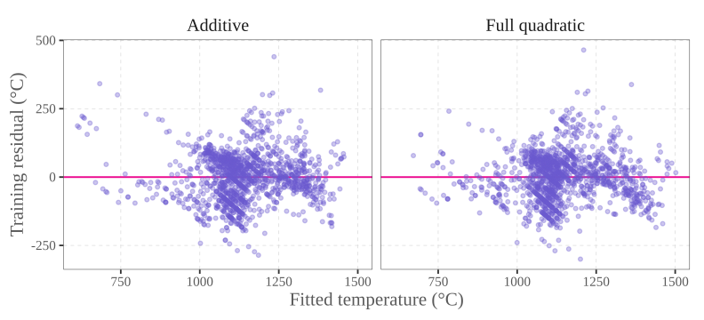{fig-alt="Training residuals against fitted temperature for the additive three-oxide model and the full quadratic, on common axes. Both use the same 1,402 training observations; pink horizontal lines mark zero residual."}
::::::

:::::: {.small}
**Residual = observed − fitted temperature.** Do squared terms and interactions remove systematic patterns?

Look again for **curvature, changing spread, clusters, and unusual observations**.
::::::

## Adding predictors and R-squared {.r2-lesson}

:::::: {.columns}
::::: {.column width="64%"}
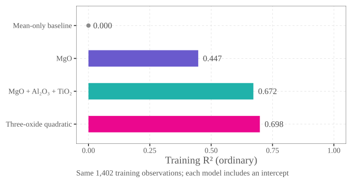{fig-alt="Ordinary training R-squared for nested models fitted to the same 1,402 CPX observations: mean-only baseline 0.000, MgO regression 0.447, MgO plus Al2O3 plus TiO2 regression 0.672, and the full three-oxide quadratic with squared terms and interactions 0.698. The horizontal scale spans zero to one."}
:::::
::::: {.column width="36%"}
[**Adding predictors cannot decrease training $R^2$.**]{.purple}

The larger model can recover the smaller one by setting the extra coefficients to **zero**. Least squares therefore cannot fit worse.

:::: {.small}
The models must use the **same observations**, include an intercept, and retain the earlier predictors.

$R^2$ can stay unchanged. This rule concerns **ordinary $R^2$**, not adjusted $R^2$.
::::
:::::
::::::

:::::: {.takeaway .small}
Higher training $R^2$ alone does not establish better predictions.
::::::

## A degree-10 polynomial using MgO {.polynomial-lesson}

$$T=\beta_0+\sum_{k=1}^{10}\color{#eb078e}{\beta_k z^k}+\varepsilon.$$

:::::: {.columns}
::::: {.column width="64%"}
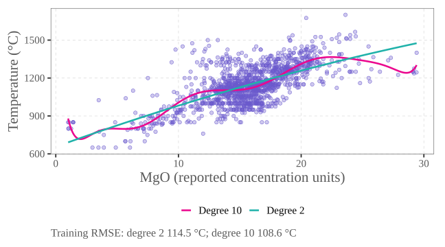{fig-alt="Actual CPX training observations in purple, with a turquoise degree-2 MgO fit and a pink degree-10 MgO fit. Training RMSE decreases from 114.5 to 108.6 degrees Celsius; test accuracy is not assessed here."}
:::::
::::: {.column width="36%"}
**11 coefficients**, using only MgO.

:::: {.small}
$z$: MgO rescaled to $[-1,1]$ for numerical stability. This remains a degree-10 polynomial in MgO.

Extra powers allow a more flexible curve.

Training observations only. Lower training error does not guarantee better test predictions.
::::
:::::
::::::

## Fit the degree-10 model in Python {.regression-code}

:::::: {.small}
Rescale MgO, then fit its powers from degree 1 through degree 10.
::::::

```python
from cpx_lesson import load_data
import statsmodels.formula.api as smf

train, _ = load_data()
lo, hi = train.MgO_Cpx.min(), train.MgO_Cpx.max()
train["z"] = 2 * (train.MgO_Cpx - lo) / (hi - lo) - 1
terms = " + ".join(f"I(z**{k})" for k in range(1, 11))
poly10 = smf.ols("T_C ~ " + terms, data=train).fit()
print(f"Training R² = {poly10.rsquared:.3f}")
```

:::::: {.small}
`range(1, 11)` supplies powers 1–10; the formula includes an intercept. Keep `lo` and `hi` to apply the same rescaling to future observations.
::::::

## Overfitting

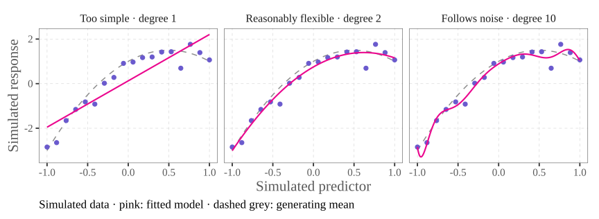{width="94%" fig-alt="Simulated example: the same 18 noisy observations are fitted by degree-1, degree-2 and degree-10 polynomials. The degree-1 model misses the curved mean; degree 2 captures it; degree 10 follows more noise. A dashed grey curve shows the generating mean."}

:::::: {.small}
**Simulated data, not CPX:** greater flexibility reduces training error here, but can also follow noise. Smaller training error does not guarantee better predictions.
::::::

:::::: {.takeaway .small}
[Must a degree-10 polynomial predict better than a degree-2 polynomial?]{.pink}
::::::

## {#box-models .box-slide}

:::::: {.columns}
::::: {.column width="80%"}
:::: {.box-quote}
“All models are wrong, but some are useful.”
::::

:::: {.caption}
George E. P. Box (1979), [*Robustness in the Strategy of Scientific Model Building*](https://www.sciencedirect.com/science/chapter/edited-volume/pii/B9780124381506500182), in *Robustness in Statistics*, pp. 201–236; quotation on p. 202.
::::
:::::
::::: {.column width="20%"}
{width=180 fig-alt="Stylized portrait illustration of George E. P. Box with glasses, smiling with his cheek resting on his hand."}
:::::
::::::

:::::: {.columns}
::::: {.column width="50%"}
### A straight-line mean

Summarizes an average trend with few coefficients.
:::::
::::: {.column width="50%"}
### A polynomial mean

Can describe curvature, while still omitting experimental processes.
:::::
::::::

:::::: {.takeaway}
Usefulness depends on the scientific purpose, the supported domain, and the acceptable prediction error.
::::::

## Training and test datasets

:::::: {.columns}
::::: {.column width="65%"}
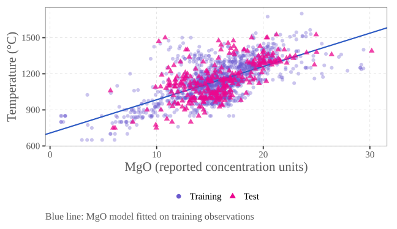{fig-alt="The unchanged CPX split: purple training circles and pink test triangles. The blue MgO regression line uses training observations only."}
:::::
::::: {.column width="35%"}
[**Training:**]{.purple} estimate the model's coefficients.

[**Test:**]{.pink} predict without refitting, then compare with the known experimental temperatures.

:::: {.small}
Good fit on the observations used to estimate a model does not guarantee accurate predictions for other observations.
::::
:::::
::::::

## Model complexity versus out-of-sample error

:::::: {.columns}
::::: {.column width="63%"}
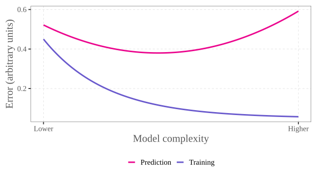{fig-alt="Schematic only: training error decreases as complexity increases, while an illustrative prediction-error curve first falls and then rises. These are not calculated CPX results."}
:::::
::::: {.column width="37%"}
Too little flexibility can miss a real pattern.

More flexibility can also follow random variation.

:::: {.small}
[Schematic only:]{.purple} a U-shaped prediction-error curve is illustrative, not guaranteed.

Keep the test set for the final assessment; do not repeatedly use it to choose polynomial complexity.
::::
:::::
::::::

## Model complexity: an example with TiO₂

:::::: {.columns}
::::: {.column width="64%"}
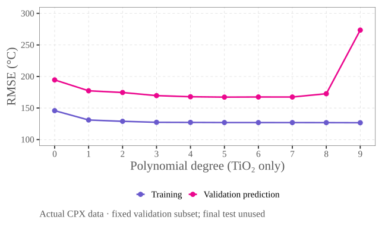{fig-alt="Measured CPX errors for TiO2-only polynomial degrees 0–9 on the same fixed fitting/validation split within the original training data. Training RMSE decreases from 145.9 to 126.7 degrees Celsius. Validation RMSE falls from 194.6 to 167.3 at degree 5, then rises at high degrees, reaching 273.5 at degree 9. Displayed degrees are plotted without smoothing; the final test observations are unused."}
:::::
::::: {.column width="36%"}
[Training error]{.purple} decreases, then levels off.

[Validation error]{.pink} initially falls, then rises at high degrees.

:::: {.small}
Degree **0** predicts the fitting mean.
::::
:::::
::::::

## How accurate are our temperature predictions? {.prediction-math}

:::::: {.small}
Models are fitted using training observations and evaluated using observations that were not used for fitting.
::::::

:::::: {.columns}
::::: {.column width="58%"}
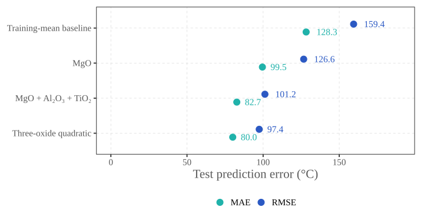{fig-alt="Test MAE and RMSE in degrees Celsius for four CPX models: training-mean baseline 128.3 and 159.4; MgO 99.5 and 126.6; MgO plus Al2O3 and TiO2 82.7 and 101.2; full three-oxide quadratic with squared terms and interactions 80.0 and 97.4. All models are fitted on training observations and evaluated on the same frozen test observations."}
:::::

::::: {.column width="42%"}
$$\mathrm{MAE}=\frac{1}{n_{\mathrm{test}}}\sum_{i=1}^{n_{\mathrm{test}}}|T_i-\hat T_i|$$
$$\mathrm{RMSE}=\sqrt{\frac{1}{n_{\mathrm{test}}}\sum_{i=1}^{n_{\mathrm{test}}}(T_i-\hat T_i)^2}$$

:::: {.caption}
$n_{\mathrm{test}}$: number of test observations; $T_i$: measured temperature; $\hat T_i$: prediction. Both errors are in °C.
::::

:::::
::::::

:::::: {.takeaway .small}
[Is a prediction error of approximately 100°C acceptable for geological applications?]{.pink}
::::::

## AIC: balancing fit and model complexity

:::::: {.columns}
::::: {.column width="55%"}
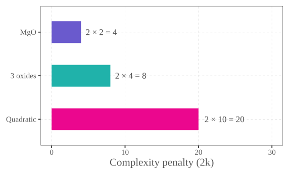{fig-alt="The AIC complexity penalty is twice the number of regression coefficients, including the intercept: 4 for MgO, 8 for the three-oxide model, and 20 for the full quadratic."}
:::::
::::: {.column width="45%"}
$$\mathrm{AIC}=\underbrace{{\color{#6A5ACD}-2\log\hat L}}_{\text{fit}}+\underbrace{{\color{#eb078e}2k}}_{\text{complexity}}$$

[Better fit]{.purple} lowers the first term; [more coefficients]{.pink} increase the penalty.

:::: {.small}
$\hat L$: maximized likelihood—how well the fitted model accounts for the data under its error assumptions.

$k$: fitted regression coefficients, including the intercept, using the `statsmodels` OLS convention here.

Compare the **same response and observations** under the same type of error model.
::::
:::::
::::::

:::::: {.takeaway .small}
[**Lower AIC is preferred among the candidate models.**]{.pink} It balances fit and complexity; it is not a prediction error in °C.
::::::

## AIC for our three CPX models {.regression-code .selection-code}

:::::: {.small}
Fit the same training observations; compare each fitted model's `.aic`.
::::::

:::::: {.columns}
::::: {.column width="58%"}
```python
from cpx_lesson import load_data
import statsmodels.formula.api as smf
import pandas as pd

train, _ = load_data()
linear = "MgO_Cpx + Al2O3_Cpx + TiO2_Cpx"
squares = ("I(MgO_Cpx**2) + I(Al2O3_Cpx**2)"
           " + I(TiO2_Cpx**2)")
formulas = {
    "MgO": "T_C ~ MgO_Cpx",
    "3 oxides": "T_C ~ " + linear,
    "Quadratic": f"T_C ~ ({linear})**2 + {squares}"
}
fits = {n: smf.ols(f, data=train).fit()
        for n, f in formulas.items()}
aic = pd.Series({n: m.aic for n, m in fits.items()})
print(aic.round(1).to_string())
```
:::::
::::: {.column width="42%"}
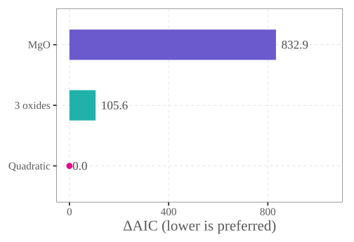{fig-alt="Training delta AIC for the fixed models: MgO 832.9, three oxides 105.6, and quadratic 0.0. Delta AIC is measured relative to the lowest AIC of these three models."}

:::: {.small}
$\Delta\mathrm{AIC}=\mathrm{AIC}-\text{smallest AIC}$.

Here AIC favors the **quadratic**, under the working OLS assumptions.

Check predictive performance too.
::::
:::::
::::::

## Model selection: many models, one search strategy {.model-search-lesson}

:::::: {.columns}
::::: {.column width="54%"}
Our three-oxide quadratic has **9 candidate terms**: 3 linear terms, 3 squares, and 3 products.

$$\color{#6A5ACD}{2^9}=\color{#eb078e}{512\text{ possible subsets}}$$

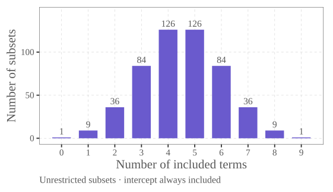{fig-alt="Combinatorial illustration, not CPX model evaluations: choosing subsets of nine terms gives 1, 9, 36, 84, 126, 126, 84, 36, 9 and 1 possibilities for model sizes zero through nine. These sum to 512, with an intercept in every model, before scientific constraints."}
:::::
::::: {.column width="46%"}
[Forward selection using AIC]{.purple}

1. Start with an **intercept-only** model.
2. Try adding each allowed term, one at a time.
3. Keep the addition with the **lowest AIC**, if it lowers the current AIC.
4. Repeat until no allowed addition lowers AIC.

:::: {.small}
Choose candidate terms scientifically. Retain main terms when including their squares or interactions; such constraints reduce the search space.
::::
:::::
::::::

:::::: {.takeaway .small}
Forward search need not find the **lowest AIC among all subsets**. Check predictive performance with cross-validation next.
::::::

## Cross-validation: rotate the validation observations

:::::: {.columns}
::::: {.column width="65%"}
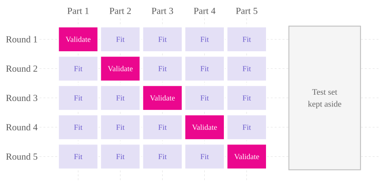{fig-alt="Five-fold cross-validation diagram: in each of five rounds, four parts are used for fitting and a different fifth part for validation. A separate test set stays outside the rotation."}
:::::
::::: {.column width="35%"}
1. Split the training data into **five parts**, called folds.
2. Fit on four; predict the remaining part.
3. Repeat five times and combine the prediction errors.

:::: {.small}
Refit the model every time. Any learned preprocessing must also be fitted within each round.

Keep the separate test set for the final assessment.
::::
:::::
::::::

:::::: {.takeaway .small}
Each observation is predicted by a model that **did not use it for fitting**.
::::::

## Cross-validation for the CPX models {.regression-code .selection-code}

:::::: {.small}
Use the same three formulas and five fixed folds inside the training data.
::::::

:::::: {.columns}
::::: {.column width="62%"}
```python
from cpx_lesson import load_data, cv_folds, selection_formulas
import statsmodels.formula.api as smf
import numpy as np, pandas as pd
train, _ = load_data()
fold = cv_folds(train)
scores = {}
for name, formula in selection_formulas().items():
    squared = []
    for v in range(5):
        fit = smf.ols(formula, train[fold != v]).fit()
        valid = train[fold == v]
        error = valid.T_C - fit.predict(valid)
        squared.extend(error ** 2)
    scores[name] = np.sqrt(np.mean(squared))
print(pd.Series(scores, name="CV RMSE").round(1))
```
:::::
::::: {.column width="38%"}
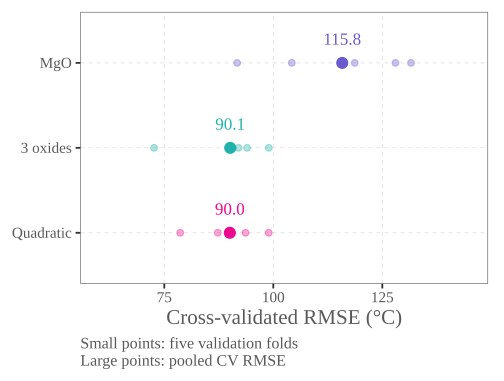{fig-alt="Five-fold cross-validated pooled RMSE: MgO 115.8 degrees Celsius, three oxides 90.1, and quadratic 90.0. Small points show the individual validation-fold RMSE values; these are not confidence intervals."}

:::: {.small}
The three-oxide and quadratic models have **very similar CV error** here.

The supplied folds keep related observations together. The test set is unused in this calculation.
::::
:::::
::::::

## How uncertain is a temperature prediction? {.uncertainty-lesson}

:::::: {.interval-question}
A model predicts **1,200 °C**. How uncertain is this prediction?
::::::

:::::: {.columns}
::::: {.column width="70%"}
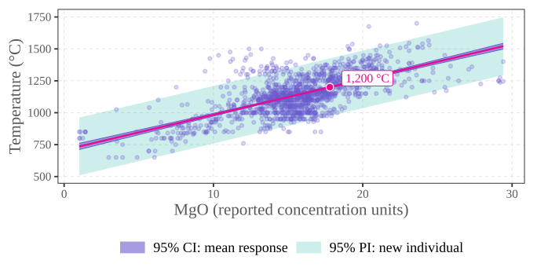{fig-alt="Experimental training observations and the pink simple MgO regression line. A narrow purple pointwise 95 percent confidence band for the conditional mean lies inside a wider turquoise 95 percent prediction band for one new individual observation. The pink marker identifies a fitted temperature of 1,200 degrees Celsius."}
:::::
::::: {.column width="30%"}
:::: {.interval-explanation}
[Confidence interval]{.purple}: uncertainty about the **conditional mean** $E[T\mid\mathrm{MgO}]$.

Here: **1,193–1,207 °C**.

[Prediction interval]{.turquoise}: for **one new individual observation** at the same MgO.

Here: **975–1,425 °C**.

The prediction interval is wider: it adds **residual variation** to uncertainty about the mean.
::::
:::::
::::::

:::::: {.interval-assumptions}
**Classical model assumptions:** a correct linear mean and independent, normally distributed errors with constant variance. Pointwise 95% bands from the training fit; no coverage claim for natural crystals or other experimental settings.
::::::

:::::: {.takeaway .interval-reflection}
Why can we estimate an average more precisely than predict one individual observation?
::::::

## Computing confidence and prediction intervals {.regression-code .interval-code}

:::::: {.columns}
::::: {.column width="48%"}
[Classical 95% intervals at MgO $x_0$]{.purple}

$$\hat T_0=\hat\beta_0+\hat\beta_1x_0,\qquad
h_0=\frac1n+\frac{(x_0-\bar x)^2}{\sum_{i=1}^n(x_i-\bar x)^2}.$$

$$\color{#6A5ACD}{\mathrm{CI}:}\quad
\hat T_0\pm t_*\,s\sqrt{h_0}$$

$$\color{#167c77}{\mathrm{PI}:}\quad
\hat T_0\pm t_*\,s\sqrt{{\color{#20B2AA}1}+h_0}$$

:::: {.interval-definitions}
$$s^2=\frac{\sum_{i=1}^n(T_i-\hat T_i)^2}{n-2},
\qquad t_*=t_{n-2,\,0.975}.$$

$n$: training sample size; $x_i$: training MgO; $\bar x$: its mean. $t_*$ is the 97.5th percentile of a $t$ distribution with $n-2$ degrees of freedom.

The extra [**1**]{.turquoise} adds **residual variance $s^2$** when predicting an individual observation.
::::

:::: {.interval-output-key}
`mean_ci_*`: mean CI; `obs_ci_*`: individual PI. All in °C.
::::
:::::
::::: {.column width="52%"}
```python
from cpx_lesson import load_data
import statsmodels.formula.api as smf
import pandas as pd

train, _ = load_data()
simple = smf.ols("T_C ~ MgO_Cpx", data=train).fit()
b0, b1 = simple.params
x0 = (1200 - b0) / b1  # fitted T = 1200 °C
new = pd.DataFrame({"MgO_Cpx": [x0]})
prediction = simple.get_prediction(new)
row = prediction.summary_frame(alpha=0.05).iloc[0]
keys = ["mean", "mean_ci_lower", "mean_ci_upper",
        "obs_ci_lower", "obs_ci_upper"]
print(row[keys].round(1).to_string())
```
:::::
::::::

:::::: {.interval-code-assumptions}
Pointwise intervals under a correct linear mean and independent, normal errors with constant variance. Same experimental scope as the preceding slide.
::::::

## Ice cream and sharks: association or cause?

:::::: {.columns}
::::: {.column width="60%"}
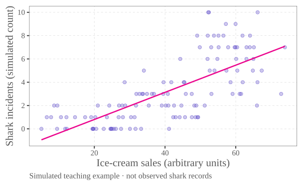{fig-alt="Clearly simulated teaching data show a positive association between ice-cream sales and shark-incident counts, with a pink fitted line. These are not observed shark records."}
:::::
::::: {.column width="40%"}
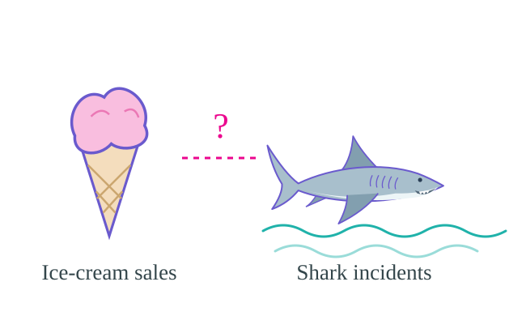{fig-alt="Original vector illustration of an ice-cream cone and a shark, linked by a question mark rather than a causal arrow."}

Does buying more ice cream **cause** more shark incidents?

:::: {.small}
A fitted line shows an association. It does not, by itself, explain why the variables move together.
::::
:::::
::::::

## Shark incidents through the year

:::::: {.columns}
::::: {.column width="72%"}
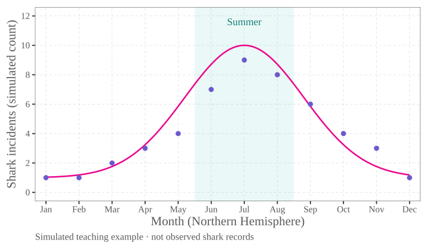{fig-alt="Simulated monthly shark-incident counts and a smooth illustrative seasonal curve, peaking in Northern Hemisphere summer. June to August is shaded. This is a teaching simulation, not observed shark data."}
:::::
::::: {.column width="28%"}
[**What do you think?**]{.pink}

What else might vary between winter and summer?

Could it also affect ice-cream sales?

:::: {.small}
Points: simulated monthly counts.

Pink curve: the illustrative seasonal pattern used to generate them.
::::
:::::
::::::

## A common cause: warmer beach weather {.confounding-story}

:::: {.cause-figure}
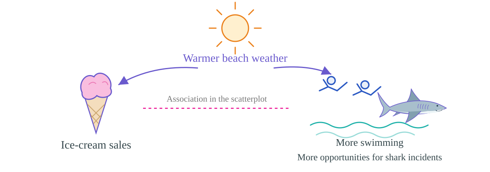{fig-alt="Original common-cause illustration: warmer beach weather points toward ice-cream sales and toward more swimming, giving more opportunities for shark incidents. A dashed line between sales and incidents marks an association, with no direct causal arrow."}
::::

:::: {.cause-statements}
[**Confounder:**]{.purple} a common cause can create an association between two other variables.

[**Here:**]{.turquoise} warmer weather can raise ice-cream demand and bring more people into the water.

[**Regression lesson:**]{.pink} a coefficient—or a good prediction—does not establish causation.
::::

