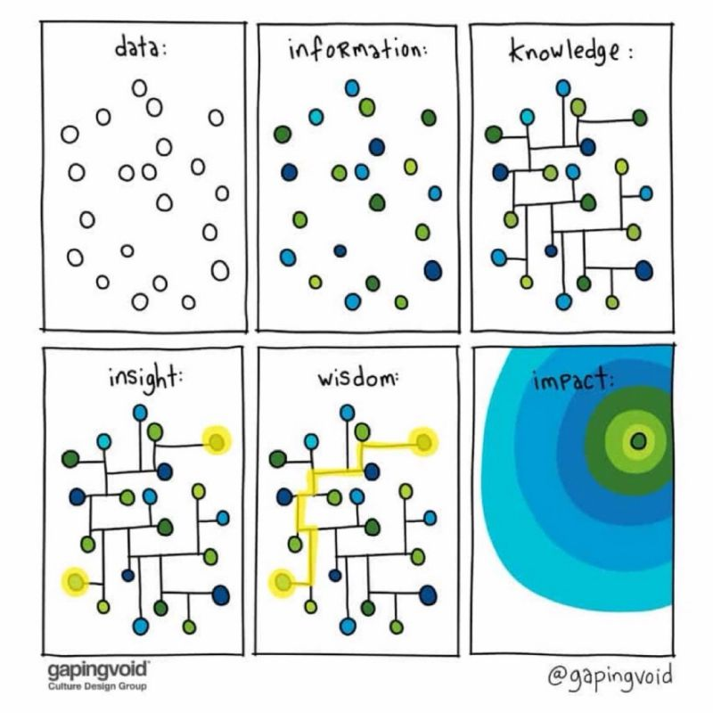
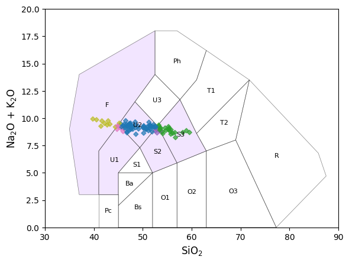
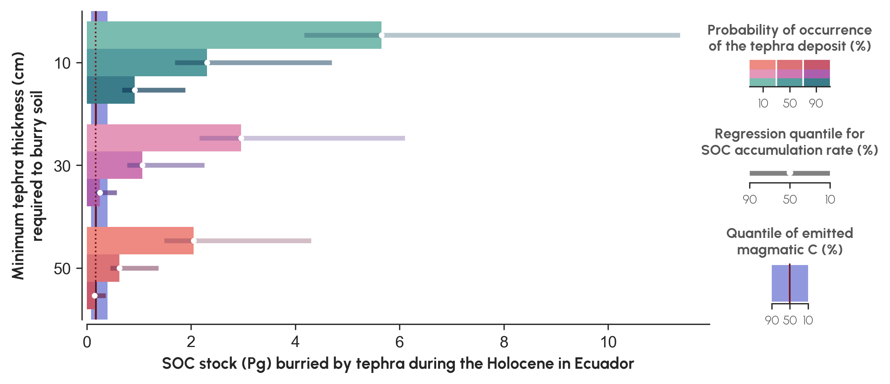
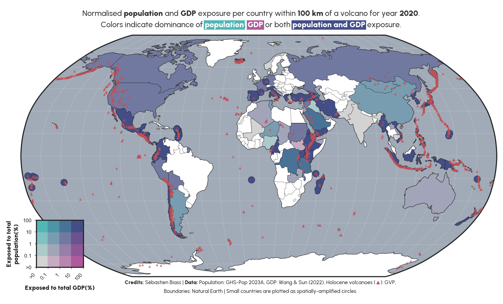
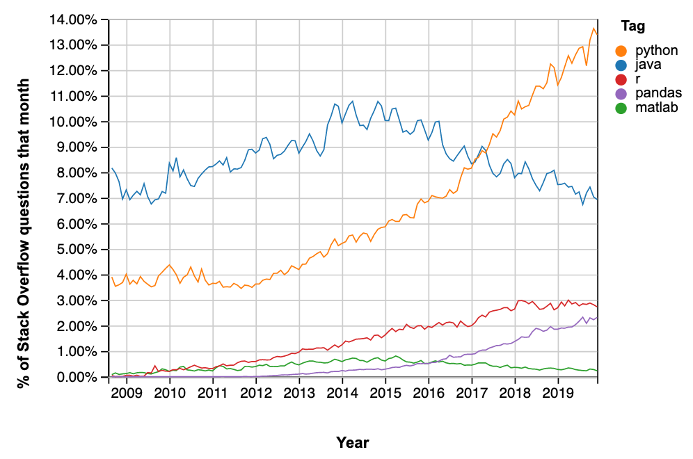
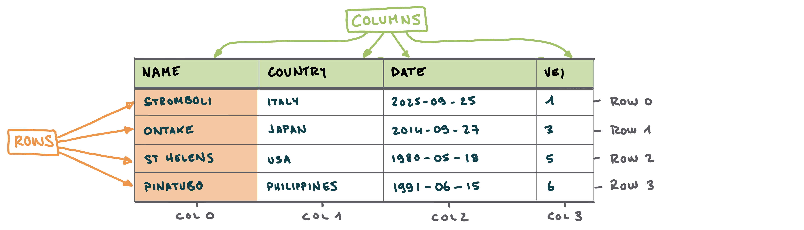
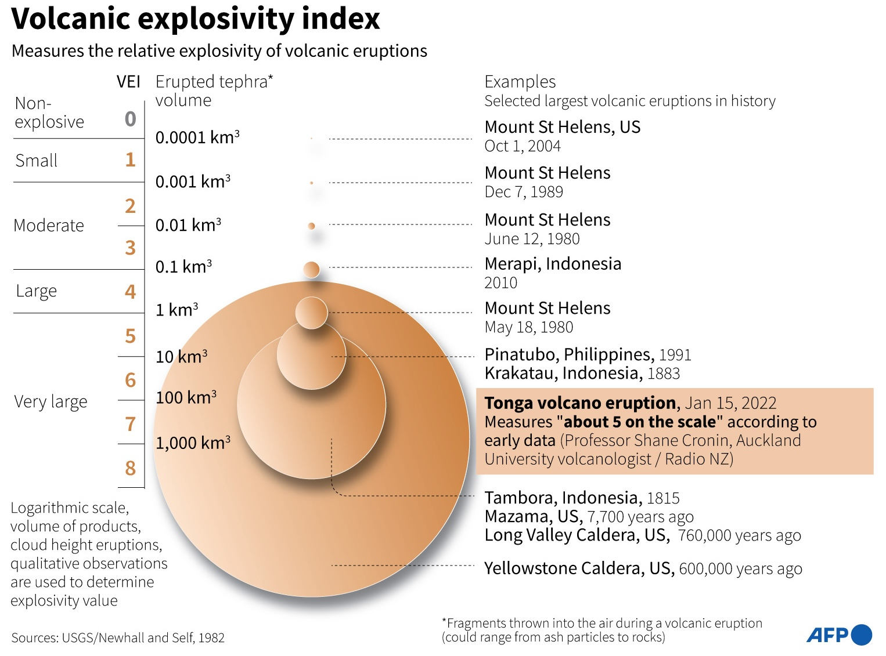

## Get ready

- Go to [https://elste-master.github.io/Data-Science/](https://elste-master.github.io/Data-Science/)
  - **Download slides:** Class 1 > [Overview]{.alert}
  - **Setup VS Code:** Appendices > [Setup VS Code]{.alert}

<span style="font-size: 0.5em;"></span>

<iframe src="../appendices/setup_vscode.html" width="100%" height="400px" style="border:none;"></iframe>


## Why this class?

### Data deluge: The big EO data landscape

{width=80% fig-align="center"}

- **Landsat:**
  - Download: 53 images/day (2001) - 220’000 images/day (2017)
  - 5 million images of the Earth surface → [> 5 PB]{.alert}
- **ESA Sentinel 1 & 2** → [4.6TB /daily!]{.alert}


## Why this class?

:::: {.columns}
::: {.column width="50%"}
**As scientists, we are exposed to**:

- Increasing computational power/facilities
- Increasing amount of data

::: {.fragment}
**How do we make sense of it all?**

- [Scientific coding]{.alert} → gateway to scientific data analysis
- [Data science]{.alert} → extracting meaningful infomation and insights from data
:::
:::
::: {.column width="50%"}

:::
::::

## What is [data science]{.alert}

### Wikipedia

> Data science is an [interdisciplinary academic field]{.alert} that uses statistics, scientific computing, scientific methods, processing, scientific visualization, algorithms and systems to extract or extrapolate knowledge from [...] data.

::: {.fragment}

### National Institutes of Standards and Technology

> The field that combines domain expertise, programming skills, and knowledge of mathematics and statistics to [extract meaningful insights from data]{.alert}.
:::

## Class schedule

- **Fall part at UNIGE**: 6 $\times$ 3-h long sessions
- **Assistants**: Sofia Hernandez Castro, Henry Hoult
- **Format**: Theory, live coding and exercises

### October 14 and 21

- **Seb** → Exploratory data analysis

### October 28, November 4 and 11

- **Stéphane** → Inference

### November 18

- Question session + exam

## Class objectives

- Scientific coding and stats often appear daunting
- True, there can be a steep learning curve


<span style="font-size: 0.5em;"></span>

::: {.fragment}
### Objectives

- **Not** to make you and expert developer / statistician **but**
  - Motivate scientific reasoning
  - Develop statistical thinking

:::

## Get involved!!!

**We want this class to be useful for [your research]{.alert}**!

<span style="font-size: 0.5em;"></span>

Try to contextualise the course material to **your research**:

- Do you already have your own [datasets]{.alert} you could bring to class?
- Can you use the course to [formulate new research questions]{.alert}?
- Do you know any open-access datasets relevant to your fields?
  - If not, can you find some for the next weeks?


# Why coding? {background-color="#2F4647"}


## Motivations

- **Example**: A common - but unnecessarily complicated - workflow of [many specialised softwares]{.alert}

```{mermaid}
%%{init: {"theme":"dark"}}%%
flowchart LR
    B[Data Collection]
    B --> C[Data Cleaning]
    C --> D[Analysis]
    D --> E[Visualisation]
```


::: {.fragment}
- **Objective**: Integrate full research workflow in an environment [supporting all tasks]{.alert}

```{mermaid}
flowchart LR
    B[Start]
    B --> C[""]
    C --> D[End]
```
:::


## Motivations

### Motivation 1: Automation

:::: {.columns}
::: {.column width="60%"}

**Cotopaxi volcano**

- Reconstructing eruption source parameters (ESP) from tephra deposits
    - *How do different measurement methods influence ESP estimates*?

::: {.fragment}
- 40 outcrops
- ~10 samples per outcrop
- ~7 measurement methods per sample
:::


:::
::: {.column width="40%"}
{width=100%}
:::
::::


## Motivations

### Motivation 2: Data analysis

:::: {.columns}
::: {.column width="48%"}

**Example 1**: Exploit catalogues of big Earth Observation data

- **Revisit big EO catalogues to infer new knowledge**
    - *What controls the impact and recovery of vegetation following eruptions*?
:::
::: {.column width="4%"}
:::
::: {.column width="48%"}
{width=100%}

:::
::::

## Motivations
### Motivation 2: Data analysis

:::: {.columns}
::: {.column width="48%"}

**Example 2**: Streamline global geochemical analyses

- **Access global databases**
  - e.g., *Georock* database 
- **Automatic dedicated analyses/plots**
  - e.g., *TAS* diagrams and classification using `pyrolite`

:::
::: {.column width="4%"}
:::
::: {.column width="48%"}

{width=100%}

:::
::::


## Motivations
### Motivation 3: Visualisation

**Example 1**: In volcanically-active regions, soil burial after explosive eruptions [capture more carbon that they emit]{.alert}.



## Motivations
### Motivation 3: Visualisation

**Example 2**: In Small Island States, [≥90% of population and GDP]{.alert} is exposed to volcanic hazards.

{width=90% fig-align="center"}


# Why Python?  {background-color="#2F4647"}

## Python's advantages [^1]

:::: {.columns}
::: {.column width="50%"}

1. **Free**
2. **Open source**
   - Not dependent on any company
   - Large online community
3. **Old** → stable (started in 1991)
4. **Very** popular in science
5. Relatively easy to learn

:::
::: {.column width="50%"}
{width=120%}
:::
::::

[^1]: Inspired by the [School of Oceanography at University of Washington](https://www.youtube.com/watch?v=O3DnvPuw8Ro&list=PLjazLUieaXOWl-4ZUn4VWabP5-Tb74ZbR&index=3)

## What is Python

**High-level computing language**

- Compiled → doesn't directly speak to the computer, but is *interpreted* by another language
  - Usually slower, but much, much [easier to use]{.alert}!

::: {.fragment}
**Modular**

- Python is composed of a *core* of functions complemented by wide ecosystem of specialized packages for [specific tasks]{.alert}
  - A [function]{.alert} is a bit of code to perform a **specific task**
  - A [module]{.alert} is a collection of **functions**
  - A [package]{.alert} is composed by multiple **modules**
:::

## An example of packages, modules and functions

In the code below, we first load the necessary packages and libraries:

- `matplotlib` is the main **visualisation** [package]{.alert} used in Python
- `pyplot` is a [module]{.alert} of `matplotlib` that provides easy-to-use functions for **plotting** data
- `figure` is a [function]{.alert} of `pyplot` and is the main function to prepare a plot

```{python}
#| eval: false
#| echo: true
# Import the packages and modules
from matplotlib import pyplot as plt 
# Set up a figure for plotting
plt.figure(...) 

```
<!-- 1. Load the `pyplot` [module]{.alert} from the `matplotlib` [package]{.alert} 
2. The `pyplot` module provides the `figure` [function]{.alert} -->

## How to use Python 


:::: {.columns}
::: {.column width="48%"}

**Option 1**: Your own computer

- Requires some setup
- No internet connection required
- Slow if computer is slow
- All data stored on your own computer

::: {.callout-important}

Try [this tutorial](https://e5k.github.io/outils-info-2/course/semaine_01.html)

:::

:::

::: {.column width="4%"}

:::

::: {.column width="48%"}

::: {.fragment}
**Option 2**: In the cloud → [Google Collab](https://colab.google)

- No setup required
- No internet connection required
- Decent speed, free as long as Google says it is free
- All data stored in the cloud

:::
:::
::::

## How to run Python 


**3 main ways to run Python...**

1. Run Python `.py` scripts from the command line → *deprecated*
2. Run blocks of code from within a Python `.py` script using `ipykernel` → **similar behaviour to R/Matlab**
3. Use **Jupyter Notebooks** in `.ipynb` files


::: {.fragment}
**...in two different environments**

1. Dedicated software: [VSCode](https://code.visualstudio.com/docs/python/jupyter-support-py), [PyCharm](https://www.jetbrains.com/pycharm/), [Spyder](https://www.spyder-ide.org)
2. Web browser: [JupyterLab](https://jupyter.org)
:::


# How to approach coding {background-color="#2F4647"}

## Python as a natural language

| Natural language | Python | Example |
|---|---|---|
| Noun | Object or variable | `df` |
| Verb | Function or method | `mean()`, `sort_values()` |
| Complement | Target variable | `"altitude"` |
| Adverb | Argument specifying how | `ascending=False` |
| Sentence | Instruction | `df.sort_values(...)` |

```python
df.sort_values("altitude", ascending=False)
```

::: {.callout-important}
Python checks the grammar of your code. **You** must check the [scientific meaning]{.alert} of the sentence.
:::

::: {.notes}
This is an analogy, not an exact grammatical correspondence. A variable refers to an object, and an argument can specify both what to work on and how to perform an operation.

Ask students to identify the table, the action, the target column and the direction of sorting. Then change ascending=False to ascending=True and have them explain the new instruction before running it.

Connect this to the teaching dataset: sorting by VEI orders the recorded eruption classes; it does not establish which volcano or country is most hazardous.
:::

## From a sentence to a sequence of tasks

<span style="font-size: 0.5em;">&nbsp;</span>

| Task | Questions to ask |
|---|-------|
| [**Load**]{.alert} | Where are the data? How do I read them? |
| [**Inspect**]{.alert} | What do the rows, columns and values represent? |
| [**Select / filter**]{.alert} | Which columns and observations do I need? |
| [**Transform**]{.alert} | What should I sort, recode or calculate? |
| [**Summarise / analyse**]{.alert} | What quantity or relationship answers my question? |
| [**Visualise / export**]{.alert} | How should I show or save the result? |

<!-- **Example:** “Show the dates and VEI of Indonesian eruptions with VEI ≥ 4, newest first.”

→ **Filter rows** (`Country`, `VEI`) → **select columns** (`Date`, `VEI`) → **sort** (`Date`, descending) -->

::: {.notes}
These are practical categories, not a rigid sequence: an analysis often loops back to inspection or selection.

Translate the scientific question into small tasks in plain language, then choose a function for each task. Here, the data have already been loaded. Filter with a Boolean mask, select columns with .loc, and sort with .sort_values(). Not every question requires all six categories.

Ask students to identify which tasks require pandas and which will later require plotting or statistical libraries. After each step, inspect the result and check that it still represents the observations you intended to analyse.
:::

# Today's plans {background-color="#2F4647"}

## Pandas

<span style="font-size: 0.5em;"></span>

`pandas`: A **package** for [data manipulation and analysis]{.alert} handling **structured data**

- **Reading/writing data** from common formats (CSV, Excel, JSON, etc.)
- Handling **missing data**
- **Filtering**, **sorting**, **reshaping** and **grouping** data
- **Aggregating** data (sum, mean, count, etc.)
- **Time series support** (date ranges, frequency conversions)
- **Statistical operations**


## Anatomy of a DataFrame




- Similar to *Excel* → contains *tabular data* composed of [rows]{.alert} and [columns]{.alert}

- In *Excel*:
  - **Rows** are accessed using *numbers*
  - **Columns** are accessed using *letters*

## Anatomy of a DataFrame


- Unlike *Excel*, **rows** and **columns** can be [labelled]{.alert}
  - [Index]{.alert} refers to the label of the **rows**. In the *index*, **values are usually unique** - meaning that each entry has a different label.
  - [Column]{.alert} refers to the label of - logically - the **columns**


## Today's dataset

Synthetic dataset of **selected volcanic eruptions** → first 5 rows:

<span style="font-size: 0.5em;"></span>

| Name            | Country     | Date                |   VEI |   Latitude |   Longitude |
|:----------------|:------------|:--------------------|------:|-----------:|------------:|
| St. Helens      | USA         | 1980-05-18 |     5 |    46.1914 |   -122.196  |
| Pinatubo        | Philippines | 1991-04-02 |     6 |    15.1501 |    120.347  |
| El Chichón      | Mexico      | 1982-03-28 |     5 |    17.3559 |    -93.2233 |
| Galunggung      | Indonesia   | 1982-04-05 |     4 |    -7.2567 |    108.077  |
| Nevado del Ruiz | Colombia    | 1985-11-13 |     3 |     4.895  |    -75.322  |
: {.table .table-striped .table-hover}

## Volcanic explosivity index (VEI)




## Today's objectives

**5 modules**:

1. How to [load data]{.alert} in a DataFrame
1. How to [access]{.alert} data → *query by label/position*
1. How to [filter]{.alert} data → *comparison and logical operators*
1. How to [rearrange]{.alert} data → *sorting values*
1. How to [operate]{.alert} on data → *arithmetic and string operations*

- We expect you to know how to get started with Python / Jupyter notebook 
- Let us know if [you are lost]{.alert} or if [you already know all of this]{.alert}
  - Let's make it useful for **your research**


## Get started

- Go to [https://elste-master.github.io/Data-Science/](https://elste-master.github.io/Data-Science/)
  - **Setup VS Code:** Appendices > [Setup VS Code]{.alert}
  - Follow [Class 1]{.alert}

**How to do it**?

- Create a [Jupyter Notebook]{.alert}
- Copy & paste code fragment → make sure you **understand** what you are doing!
  - Use the [documentation]{.alert} / [cheat sheets](https://e5k.github.io/outils-info-2/#cheat-sheets) / [companion course](https://e5k.github.io/outils-info-2/)
- Document your code with [Markdown](../appendices/jupyter_markdown_summary.qmd)


