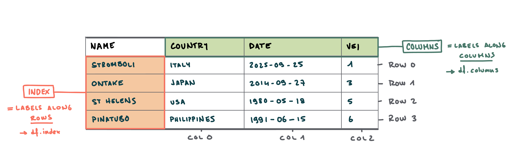
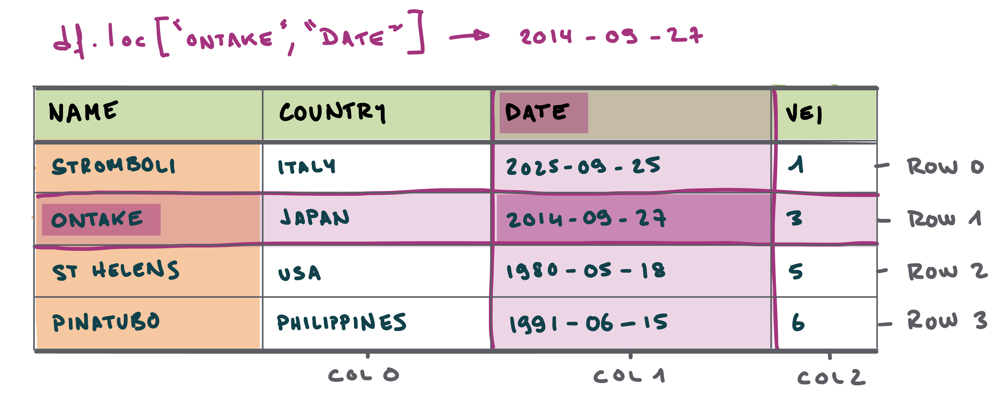
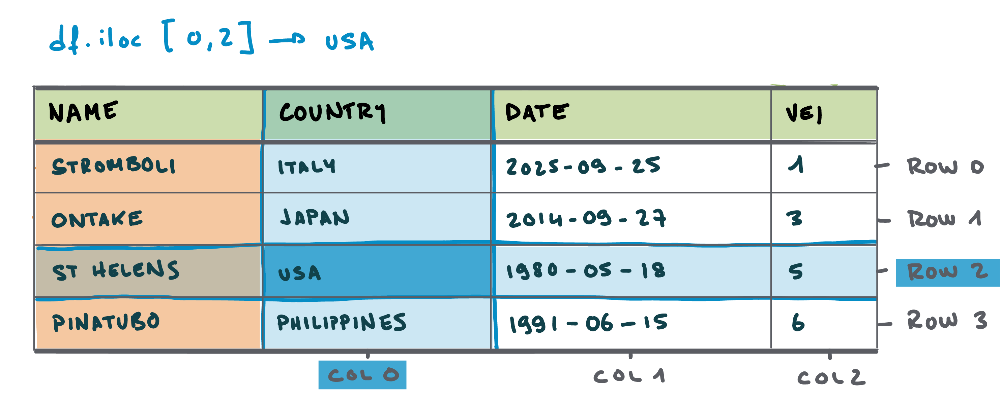

# Loading data {background-color="#2F4647"}

## Setting up the notebook {auto-animate="true"}

- We start by importing the `pandas` library
- We import it under the name [pd]{.alert} - which is faster to type!

<span style="font-size: 0.5em;"></span>

```{python}
#| eval: false
#| echo: true
# Import the required packages
import pandas as pd
```

## Setting up the notebook {auto-animate="true"}

- We then load the specified data with the `pd.read_csv()` function
- This returns a [DataFrame]{.alert} object in a variable named `df`

<span style="font-size: 0.5em;"></span>

```{python}
#| eval: false
#| echo: true
# Import the required packages
import pandas as pd

# Read the data
df = pd.read_csv('https://raw.githubusercontent.com/ELSTE-Master/Data-Science/main/Data/dummy_volcanoes.csv', parse_dates=['Date']) # Load data
```

## Setting up the notebook {auto-animate="true"}

- We print some data for inspection with `df.head()`
- The functions are now directly called from the [DataFrame]{.alert} `df` object 

<span style="font-size: 0.5em;"></span>


```{python}
#| eval: true
#| echo: true
# Import the required packages
import pandas as pd

# Read the data
df = pd.read_csv('https://raw.githubusercontent.com/ELSTE-Master/Data-Science/main/Data/dummy_volcanoes.csv', parse_dates=['Date']) # Load data

# Show the first 3 rows
df.head(3) 
```

## Setting the index



## Setting the index

- ...for now, the index (**→ the first column)** is an *integer*
- This might be acceptable in datasets where the *label* is not important

<span style="font-size: 0.5em;"></span>

```{python}
#| eval: true
#| echo: true
# Show the first 3 rows
df.head(3) 
```

## Setting the index

- Here we want to access the data using the **name of the volcano**
- We **set the index** using `set_index()`

<span style="font-size: 0.5em;"></span>

```{python}
#| eval: true
#| echo: true
# Set the index to the 'Name' column
df = df.set_index('Name')

# Show the first 3 rows
df.head(3) 
```


## Exploring data

- Here are some **basic functions** to review the structure of the dataset:

<span style="font-size: 0.5em;"></span>


| Function     | Description                                                                                   |
|--------------|-----------------------------------------------------------------------------------------------|
| `df.head()`  | Prints the *first* 5 rows of the DataFrame.                                                   |
| `df.tail()`  | Prints the *last* 5 rows of the DataFrame.                                                    |
| `df.info()`  | Displays some info about the DataFrame, including the number of rows (*entries*) and columns. |
| `df.shape`   | Returns a list containing the number of rows and columns of the DataFrame.                    |
| `df.index`   | Returns a list containing the index along the *rows* of the DataFrame.                        |
| `df.columns` | Returns a list containing the index along the *columns* of the DataFrame.                     |

: {.striped}

<span style="font-size: 0.5em;"></span>

::: {.callout-tip}
## Functions vs attributes

- **Functions** have parentheses → they **compute** something on `df`
- **Attributes** do *not* have parentheses → they store some **parameter** related to `df`


:::


## Sorting data {auto-animate="true"}

- Sorting [numerical]{.alert}, [datetime]{.alert} or [strings]{.alert} using `.sort_values`
- Importance of [documentation](https://pandas.pydata.org/docs/reference/api/pandas.DataFrame.sort_values.html) to understand [arguments]{.alert}

```{python}
#| eval: true
#| echo: true
df.sort_values('VEI').head() # Sort volcanoes by VEI in ascending number
```

## Sorting data {auto-animate="true"}

- Sorting [numerical]{.alert}, [datetime]{.alert} or [strings]{.alert} using `.sort_values`
- Importance of [documentation](https://pandas.pydata.org/docs/reference/api/pandas.DataFrame.sort_values.html) to understand [arguments]{.alert}

```{python}
#| eval: true
#| echo: true
df.sort_values('VEI').head() # Sort volcanoes by VEI in ascending number
df.sort_values('Date', ascending=False).head() # Sort volcanoes by eruption dates from recent to old
```

## Sorting data {auto-animate="true"}

- Sorting [numerical]{.alert}, [datetime]{.alert} or [strings]{.alert} using `.sort_values`
- Importance of [documentation](https://pandas.pydata.org/docs/reference/api/pandas.DataFrame.sort_values.html) to understand [arguments]{.alert}

```{python}
#| eval: true
#| echo: true
df.sort_values('VEI').head() # Sort volcanoes by VEI in ascending number
df.sort_values('Date', ascending=False).head() # Sort volcanoes by eruption dates from recent to old
df.sort_values('Country').head() # Also works on strings to sort alphabetically
```

## Sorting data {auto-animate="true"}

- Sorting [numerical]{.alert}, [datetime]{.alert} or [strings]{.alert} using `.sort_values`
- Importance of [documentation](https://pandas.pydata.org/docs/reference/api/pandas.DataFrame.sort_values.html) to understand [arguments]{.alert}

```{python}
#| eval: true
#| echo: true
df.sort_values('VEI').head() # Sort volcanoes by VEI in ascending number
df.sort_values('Date', ascending=False).head() # Sort volcanoes by eruption dates from recent to old
df.sort_values('Country').head() # Also works on strings to sort alphabetically
df.sort_values(['Latitude', 'Longitude']).head() # Sorting using multiple columns
```


## Your turn!

- Go to [https://elste-master.github.io/Data-Science/](https://elste-master.github.io/Data-Science/)
  - Class 1 > [Data Structure]{.alert}

<span style="font-size: 0.5em;"></span>

<iframe src="../class1/day1-3_data_exploration.html" width="100%" height="400px" style="border:none;"></iframe>


# Querying data {background-color="#2F4647"}


## Accessing data in a DataFrame


## Accessing data in a DataFrame

**Option 1**: [label-based]{.alert} indexing

- Use the [labels]{.alert} of **index** and **columns** to retrieve data
- Function to use: `df.loc`

::: {.fragment}

:::


## Accessing data in a DataFrame

**Option 2**: [position-based]{.alert} indexing

- Use the [positions]{.alert} of **index** and **columns** to retrieve data
- Function to use: `df.iloc`

::: {.fragment}

:::

## Label-based indexing: Rows

- **Query a [row]{.alert}** with `.loc` → Use **square brackets** `[ ]`
  - Query the *row* for which the *index label* is `Calbuco`
  - Returns all *columns*

<span style="font-size: 0.5em;"></span>

:::: {.columns}
::: {.column width="48%"}
::: {.fragment}

```{python}
#| eval: true
#| echo: true
df.loc['Calbuco']
```

→ Returns a [pd.Series]{.alert}
:::
:::

::: {.column width="4%"}
:::

::: {.column width="48%"}
::: {.fragment}
```{python}
#| eval: true
#| echo: true
df.loc[['Calbuco']]
```

→ Returns a [pd.DataFrame]{.alert}

:::
:::
::::


## Label-based indexing: Rows

- **Query [multiple rows]{.alert}**  with `.loc`
  - Query the *rows* for which the *index labels* are `Calbuco` or `Taal`
  - Returns all *columns*

<span style="font-size: 0.5em;"></span>

::: {.fragment}
```{python}
#| eval: true
#| echo: true
df.loc[['Calbuco', 'Taal']]
```
:::

## Label-based indexing: Columns

- **Query [columns]{.alert}** 
  - Query the *columns* for which the *column labels* are `Country` or `VEI`
  - Returns all *rows*

:::: {.columns}
::: {.column width="48%"}
::: {.fragment}

- **Option 1**: [with]{.alert} `.loc`:
```{python}
#| eval: true
#| echo: true
df.loc[:, ['Country', 'VEI']].head(3)
```
:::

:::

::: {.column width="4%"}
:::

::: {.column width="48%"}
::: {.fragment}
- **Option 2**: [without]{.alert} `.loc`:
```{python}
#| eval: true
#| echo: true
df[['Country', 'VEI']].head(3)
```

:::
:::
::::

## Label-based indexing: Rows and Columns

- Again, choice on whether to use `.loc` to query columns

:::: {.columns}
::: {.column width="48%"}
::: {.fragment}

- **Option 1**: Columns are specified [inside]{.alert} `.loc`:
```{python}
#| eval: true
#| echo: true
df.loc[['Calbuco', 'Taal'], ['Country', 'VEI']].head(3)
```
:::
:::

::: {.column width="4%"}
:::

::: {.column width="48%"}
::: {.fragment}
- **Option 2**: Columns are specified [outside]{.alert} `.loc`:
```{python}
#| eval: true
#| echo: true
df.loc[['Calbuco', 'Taal']][['Country', 'VEI']].head(3)
```

:::
:::
::::


## Position-based indexing

- Use **positions** instead of **labels**


## Position-based indexing: Rows

- **Query a [row]{.alert}** with `.iloc`
  - Returns all *columns*

<span style="font-size: 0.5em;"></span>

:::: {.columns}
::: {.column width="48%"}
::: {.fragment}

- **One row** (first row):

```{python}
#| eval: true
#| echo: true
df.iloc[[0]]
```
:::
:::

::: {.column width="4%"}
:::

::: {.column width="48%"}
::: {.fragment}
- **Range of rows**: (rows 3-4):
```{python}
#| eval: true
#| echo: true
df.iloc[2:4]
```

:::
:::
::::


## Position-based indexing: Rows

- Query rows [from the end]{.alert}:
- Example:
  - Get the **last 5 rows** of the DataFrame:

```{python}
#| eval: true
#| echo: true
df.iloc[-5:]
```

## Position-based and label-based queries

- Mix [position-based]{.alert} and [label-based]{.alert} indexing:
  - **Rows** → *labels*
  - **Columns** → *positions*

```{python}
#| eval: true
#| echo: true
df.iloc[0:5][['Country', 'VEI']]
```


## Your turn!

- Go to [https://elste-master.github.io/Data-Science/](https://elste-master.github.io/Data-Science/)
  - Class 1 > [Querying data]{.alert}

<span style="font-size: 0.5em;"></span>

<iframe src="../class1/day1-4_queries.html" width="100%" height="400px" style="border:none;"></iframe>


# Filtering data {background-color="#2F4647"}

## Boolean indexing

- **Filtering** data with [boolean indexing]{.alert}
  - Returns either `True` or `False` depending on whether the **condition** is satisfied


:::: {.columns}

::: {.column width="25%"}
::: {.fragment}
- Example:

<span style="font-size: 0.5em;"></span>

```{python}
#| eval: true
#| echo: true
a = 1
b = 2
```
:::
:::

::: {.column width="10%"}

:::

::: {.column width="65%"}
::: {.fragment}

- **Comparison operators**:

| Operator | Meaning                | Example      | Result      |
|----------|------------------------|--------------|-------------|
| `==`     | Equal to               | `a == b`     | `False`     |
| `!=`     | Not equal to           | `a != b`     | `True`      |
| `>`      | Greater than           | `a > b`      | `False`     |
| `<`      | Less than              | `a < b`      | `True`      |
| `>=`     | Greater than or equal  | `a >= b`     | `False`     |
| `<=`     | Less than or equal     | `a <= b`     | `True`      |
:::
:::

::::


## Boolean indexing: Example

- Query all volcanoes where `VEI == 4`

<span style="font-size: 0.5em;"></span>

:::: {.columns}

::: {.column width="30%"}
::: {.fragment}
```{python}
#| eval: true
#| echo: true
df['VEI'] == 4
```

:::
:::

::: {.column width="5%"}

:::

::: {.column width="65%"}
::: {.fragment}
```{python}
#| eval: true
#| echo: true
df.loc[df['VEI'] == 4]
```
:::
:::

::::


## Boolean indexing: Strings

- **Filtering** also works with [strings]{.alert}
  - Use **string comparison** operations

<span style="font-size: 0.5em;"></span>

- **Example**:

```{python}
#| eval: true
#| echo: true
df.loc[df['Country'] == 'Indonesia']
```


## Boolean indexing: Strings

- **Filtering** also works with [strings]{.alert}
  - Use **string comparison** operations

<span style="font-size: 0.5em;"></span>

- **String comparison operators**:
<span style="font-size: 0.5em;"></span>

| Operation         | Example                                 | Description                                         |
|-------------------|-----------------------------------------|-----------------------------------------------------|
| contains          | `df['Name'].str.contains('Soufrière')`  | Checks if each string contains a substring          |
| startswith        | `df['Name'].str.startswith('E')`        | Checks if each string starts with a substring       |
| endswith          | `df['Name'].str.endswith('o')`          | Checks if each string ends with a substring         |


## Your turn!

- Go to [https://elste-master.github.io/Data-Science/](https://elste-master.github.io/Data-Science/)
  - Class 1 > [Filtering data]{.alert}

<span style="font-size: 0.5em;"></span>

<iframe src="../class1/day1-5_filtering.html" width="100%" height="400px" style="border:none;"></iframe>


# Operations {background-color="#2F4647"}

## Data management operations

- Common [data management]{.alert} functions for pandas columns:

| Operation         | Example                                 | Description                                         |
|-------------------|-----------------------------------------|-----------------------------------------------------|
| Round             | `df['VEI'].round(1)`                    | Rounds values to the specified number of decimals   |
| Floor             | `df['VEI'].apply(np.floor)`             | Rounds values down to the nearest integer           |
| Ceil              | `df['VEI'].apply(np.ceil)`              | Rounds values up to the nearest integer             |
| Absolute value    | `df['VEI'].abs()`                       | Returns the absolute value of each element          |
| Fill missing      | `df['VEI'].fillna(0)`                   | Replaces missing values with a specified value      |

<span style="font-size: 0.5em;"></span>

::: {.fragment}
- Round the `'Latitude'` to two decimals → [make sure you store the output]{.alert}!

```{python}
#| eval: false
#| echo: true
df['Latitude'] = df['Latitude'].round(2)
```

:::

## Arithmetic operations

- [Arithmetic operations]{.alert} on parts of the DataFrame (→ *columns*) using native Python arithmetic operators

| Operation      | Symbol | Example                | Description                                 |
|----------------|--------|------------------------|---------------------------------------------|
| Addition       | `+`    | `df['VEI'] + 1`        | Adds a value to each element                |
| Subtraction    | `-`    | `df['VEI'] - 1`        | Subtracts a value from each element         |
| Multiplication | `*`    | `df['VEI'] * 2`        | Multiplies each element by a value          |
| Division       | `/`    | `df['VEI'] / 2`        | Divides each element by a value             |
| Exponentiation | `**`   | `df['VEI'] ** 2`       | Raises each element to a power              |
| Modulo         | `%`    | `df['VEI'] % 2`        | Remainder after division for each element   |

<span style="font-size: 0.5em;"></span>

::: {.fragment}
- Divide `VEI` by 2 and store results a new column (→ `VEI_halved`)

```{python}
#| eval: false
#| echo: true
df['VEI_halved'] = df['VEI'] / 2
```

:::

## Expanded arithmetic operations

- The range of [arithmetic operations]{.alert} can be expanded using `numpy`


| Operation         | Symbol       | Example                        | Description                                      |
|-------------------|--------------------------|--------------------------------|--------------------------------------------------|
| Exponentiation    | `np.power`      | `np.power(df['VEI'], 2)`       | Element-wise exponentiation                      |
| Square root       | `np.sqrt`                | `np.sqrt(df['VEI'])`           | Element-wise square root                         |
| Logarithm (base e)| `np.log`                 | `np.log(df['VEI'])`            | Element-wise natural logarithm                   |
| Logarithm (base 10)| `np.log10`              | `np.log10(df['VEI'])`          | Element-wise base-10 logarithm                   |
| Exponential       | `np.exp`                 | `np.exp(df['VEI'])`            | Element-wise exponential (e^x)                   |

<span style="font-size: 0.5em;"></span>

::: {.fragment}
- `VEI` power 2 and store results a new column (→ `VEI_pow2`)

```{python}
#| eval: false
#| echo: true
df['VEI_pow2'] = np.power(df['VEI'], 2)
```

:::

## Your turn!

- Go to [https://elste-master.github.io/Data-Science/](https://elste-master.github.io/Data-Science/)
  - Class 1 > [Operations]{.alert}

<span style="font-size: 0.5em;"></span>

<iframe src="../class1/day1-6_operations.html" width="100%" height="400px" style="border:none;"></iframe>

