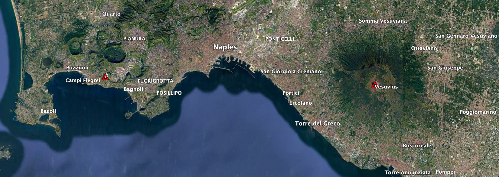
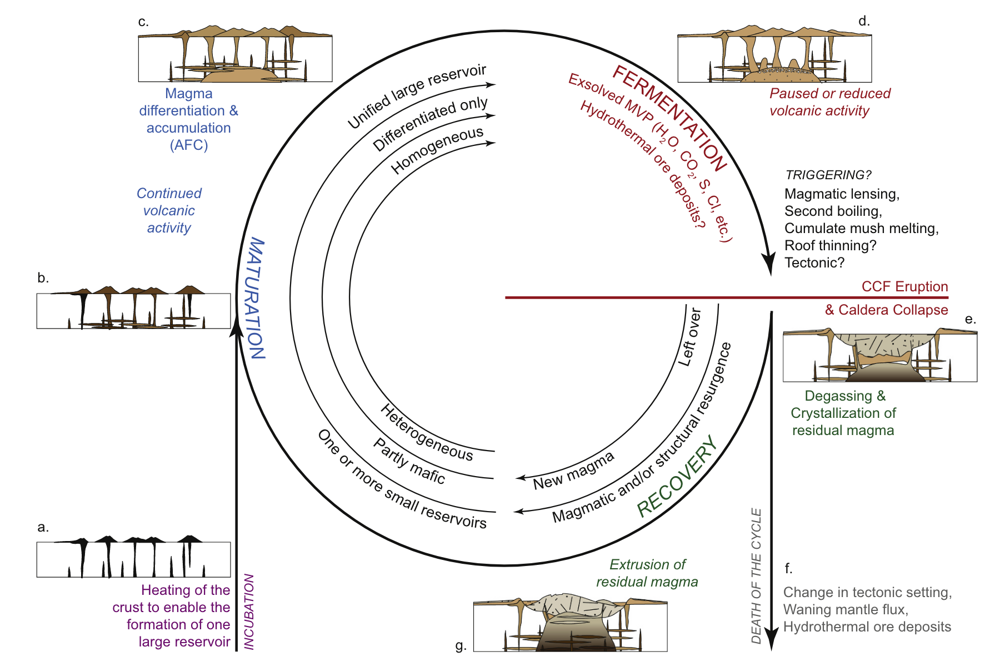
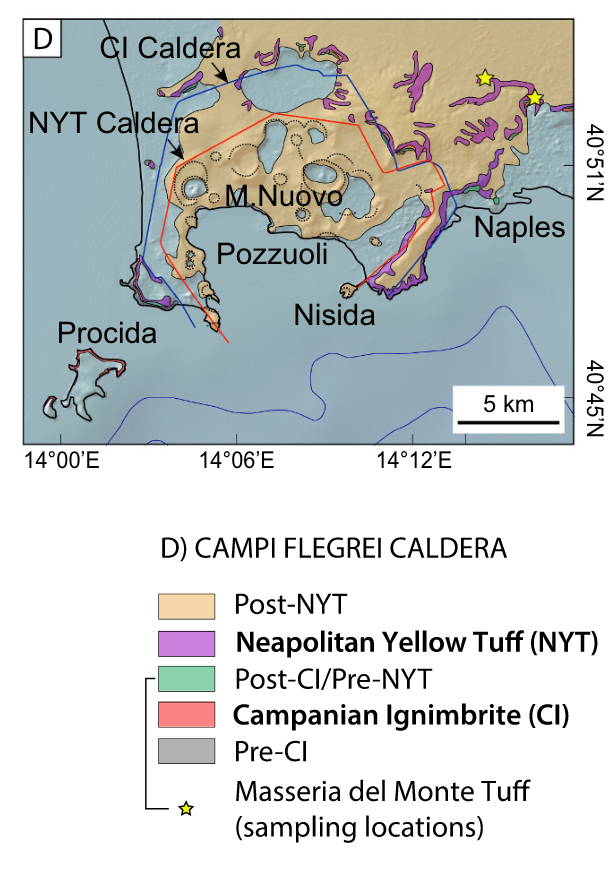
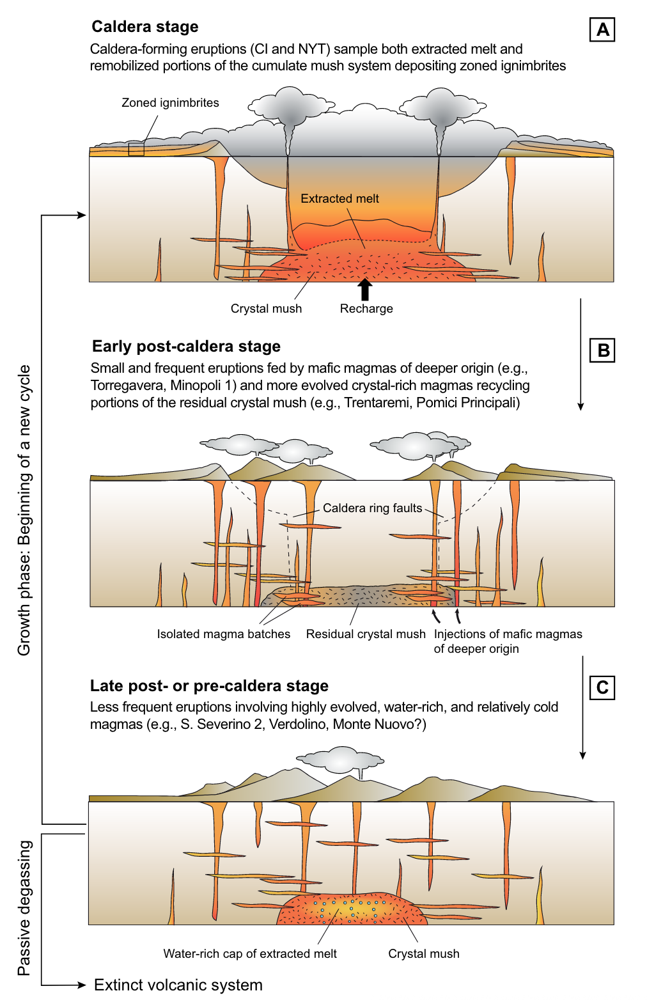
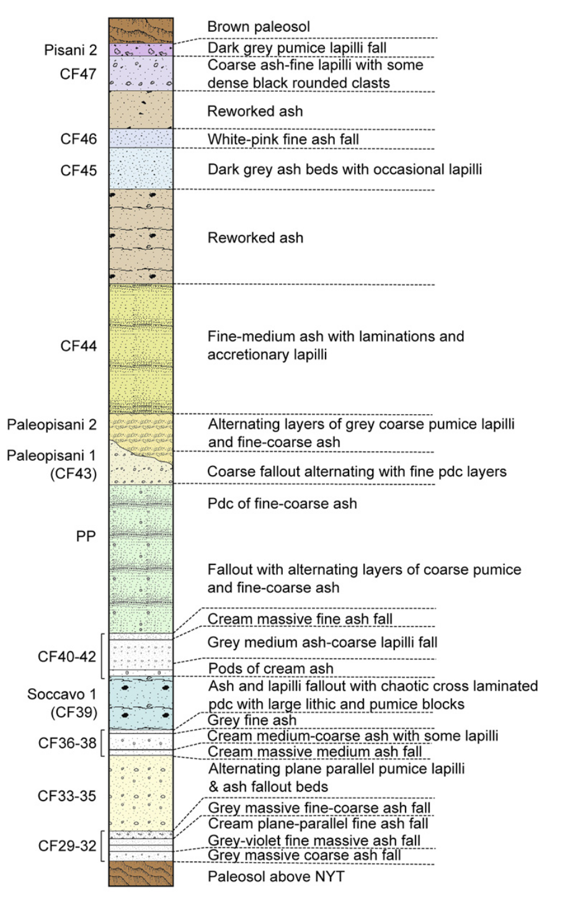

```{python}
import numpy as np
import seaborn as sns
sns.set_context('talk')
import matplotlib.pyplot as plt
plt.rcParams.update({
    "figure.facecolor":  (0.0, 0.0, 0.0, 0.0),  # red   with alpha = 30%
})
# Set colors for plotting
blue = '#2F4647'
orange = '#EB811B'
```


## Today's objectives

- **Last week**: We learned how to handle data using `Pandas`
  - Load, access, query, filter, sort and operate on data

::: {.fragment}
- **This week:** You received / compiled / produced a new dataset
- Review common tasks / method to get accustomed to the dataset
  - Understand its **structure** → what [type of data]{.alert} does it contain
  - Explore it **visually** → [plotting]{.alert} with dedicated libraries
  - Describe **single variables** → [univariate]{.alert} analyses
  - Assess coupled behaviours of **two variables** → [bivariate]{.alert} analyses
  - First attempt at **modelling** these behaviours → [linear regressions]{.alert}
:::

## Sample vs population

::: {style="width:100%; display:flex; justify-content:center; text-align: center"}

{width=80% .img-up-0 .lightbox}

:::


# The dataset {background-color="#2F4647"}

## Case study 

- **Campi Flegrei**: Home to 1.5 million people
- **Caldera-forming** eruptions
  - Campanian Ignimbrite (CI), ~39 ka ago
  - Neapolitan Yellow Tuff (NYT), ~15 ka ago



<!-- ## Caldera-forming eruptions cycles

 -->

<!-- ## Caldera cycles at Campi Flegrei


:::: {.columns}
::: {.column width="48%"}

{width="75%"}

:::

::: {.column width="4%"}
:::

::: {.column width="48%"}
{.img-up-50  width="75%"}
:::
:::: -->


## Dataset

:::: {.columns}
::: {.column width="48%"}

**Tephrostratigraphy and glass compositions of post-15 kyr Campi Flegrei eruptions**

- Smith et al. (2011)
- Major and trace elements

:::

::: {.column width="4%"}
:::

::: {.column width="48%"}
{.img-up-50  width="75%"}
:::
::::


## Loading the dataset

- Import `pandas`
- Load an **excel** file using `pandas`
- Specify **which sheet** to read from using the `sheet_name` argument
  - *Supp_majors* → `df_majors`
  - *Supp_traces* → `df_traces`


<span style="font-size: 0.5em;"></span>

```{python}
#| echo: true

# Load Pandas
import pandas as pd # Import pandas

# Import the dataset specifying which Excel sheet name to load the data from
df_majors = pd.read_csv('https://raw.githubusercontent.com/ELSTE-Master/Data-Science/main/Data/Smith_glass_post_NYT_data_majors.csv')
df_traces = pd.read_csv('https://raw.githubusercontent.com/ELSTE-Master/Data-Science/main/Data/Smith_glass_post_NYT_data_traces.csv')
```


## Inspecting the dataset

:::: {.columns}
::: {.column width="48%"}

```{python}
#| echo: true
df_traces.head(5)
```

:::

::: {.column width="4%"}
:::

::: {.column width="48%"}
```{python}
#| echo: true
df_traces.info()
```
:::
::::

# Types of data {background-color="#2F4647"}


## Basic types of data

- `int`: **Integer** numbers → 0, 1, 2, ...
- `float`: **Decimal** numbers → 1.1, 1.2, 1.3, ...
- `object`: **Strings** → "Campi Flegrei"

::: {.fragment}
**A note on *Bytes***

- `int` and `float` numbers are followed by 8, 16, 32 or 64 → **Byte** → control how much memory a variable uses
- A **Bit** is a binary digit → 0/1 → smallest possible unit of data
- `int8` can store $2^8$ digits = 256
- `int16` can store $2^16$ digits = 65'563

:::

## Families of data

<span style="font-size: 0.5em;"></span>

:::: {.columns}
::: {.column width="48%"}

### Numerical data

---

- Represent [quantities or measurable values]{.alert}
- **Quantitative**
  - *Discrete*: Earthquake counts
  - *Continuous*: Temperature
- Stored as **numerical** values
- **Operations** → arithmetic

:::

::: {.column width="4%"}
:::

::: {.column width="48%"}
::: {.fragment}


### Categorical data

---

- Represent [categories or groups]{.alert} of data
- **Qualitative** / semi-quantitative
  - *Nominal*: No order → Landslide type
  - *Ordinal*: Order → rank
- Stored as **strings** or **integer**
- **Operations** → counting, grouping
  
:::
:::
::::


## Families of data - cheat sheet


| **Feature** | **Categorical Data** | **Numerical Data** |
|--------------|----------------------|--------------------|
| **Definition** | **Categories or groups** of data |  **Quantities or measurable values** |
| **Nature** | Qualitative (describes qualities) | Quantitative (describes amounts or measurements) |
| **Data Type** | Non-numeric (often text or labels) | Numeric (numbers only) |
| **Examples** | Eruption type | Element concentration |
| **Possible Operations** | Counting, grouping, mode | Arithmetic operations |
| **Measurement Scale** | Nominal or Ordinal | Interval or Ratio |
| **Visualization Tools** | Bar chart, Pie chart | Histogram, Box plot, Scatter plot |
| **Subtypes** | **Nominal:** Categories with no order (e.g., color); **Ordinal:** Categories with order (e.g., rank) | **Discrete:** Countable numbers (e.g., number of earthquakes); **Continuous:** Measurable values (e.g., temperature) |
| **Examples of Statistical Summary** | Frequency, mode | Mean, median, standard deviation |
| **Storage Format** | Strings or labels | Integers or floats |


# Today {background-color="#2F4647"}

## Exploratory data analysis

<span style="font-size: 0.5em;"></span>

> Can [fractional crystallisation]{.alert} explain the chemical variability of Campi Flegrei glasses, or do we need [magma mixing]{.alert}?

<span style="font-size: 0.5em;"></span>

- **Univariate**: Are element concentrations narrowly distributed, broadly spread or multimodal?
- **Bivariate**: Are relationships such as Sr–Zr consistent with Sr removal by feldspar crystallisation while Zr becomes enriched in the residual melt?
- **Interpretation**: Can one differentiation process explain the observations, or are multiple magma components needed?
  - **[Correlation]{.alert} ≠ [mechanistic]{.alert} explanation**
- **Sample vs population**: Do the analysed glasses capture the compositional variability within each eruption?


## Objectives

1. Understand **data structure**
   - Type and completeness of dataset
2. Basics of **plotting** with `matplotlib` and `seaborn`
3. **Univariate** statistics
   - Position, spread, shape
   - Quantification + visualisation
4. **Bivariate** statistics
   - Covariance & Correlation
   - Intro to regression + residual analysis


## Your turn!

- Go to [https://elste-master.github.io/Data-Science/](https://elste-master.github.io/Data-Science/)
  - Class 2
  - Explore the structure of the glass geochemistry or [your]{.alert} dataset
  - Get used to the various functions

<iframe src="../class2/day2-1_intro.html" width="100%" height="400px" style="border:none;"></iframe>
